# Agent World

**Un'azienda di agenti AI che puoi guardare mentre lavora.** Scrivi una missione: la CEO la divide tra i team, i lead la scompongono, lo Skill Hub assegna le skill, il Prompt Lab affina i brief, worker e sub-agenti lavorano in loop finché il QA non approva. Tutto succede dal vivo in un ufficio 3D isometrico.


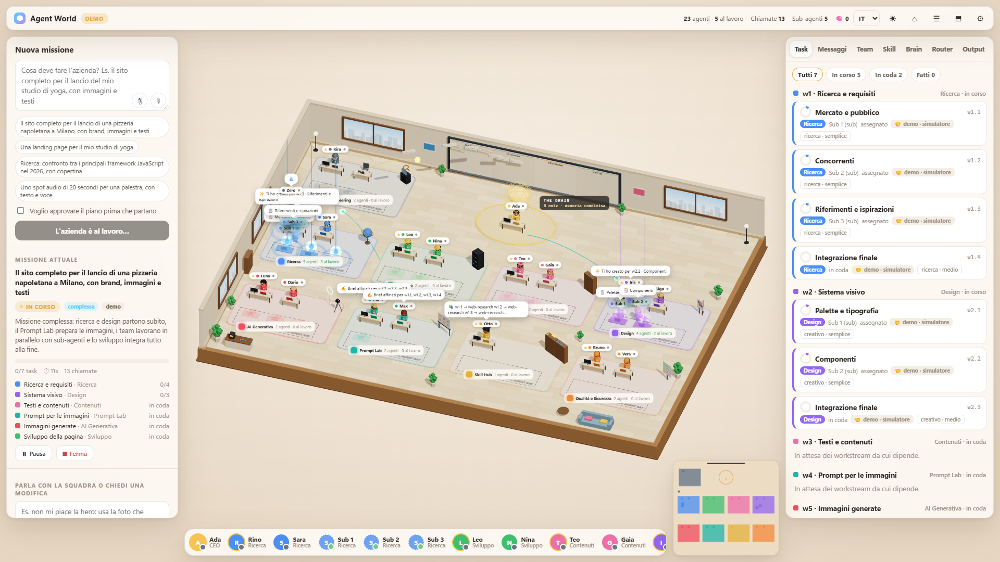

- **Nessun servizio esterno da installare.** Router dei modelli, orchestrazione, skill, memoria e mondo 3D stanno tutti in questa cartella.
- **Backend ibrido.** FastAPI (Python 3.13) dirige il lavoro; Rust (PyO3) è un acceleratore opzionale per la ricerca BM25.
- **Front-end senza build.** three.js servito così com'è; gli eventi arrivano dal server in streaming (SSE).
- **Modalità demo.** Senza chiavi API un simulatore interpreta ogni ruolo, e vedi l'intero flusso senza spendere nulla.

---

## Indice

1. [Screenshot](#screenshot)
2. [Avvio rapido](#avvio-rapido)
3. [Architettura ibrida](#architettura-ibrida)
4. [Streaming in tempo reale (SSE)](#streaming-in-tempo-reale-sse)
5. [Il bridge Python ↔ Rust](#il-bridge-python--rust)
6. [Agenti, sub-agenti e utility](#agenti-sub-agenti-e-utility)
7. [Memoria e recupero (RAG)](#memoria-e-recupero-rag)
8. [Il router OmniRoute](#il-router-omniroute)
9. [Tech stack](#tech-stack)
10. [Lingue supportate](#lingue-supportate)
11. [Configurazione](#configurazione)
12. [Test](#test)
13. [Struttura del repository](#struttura-del-repository)

---

## Screenshot

Sono catture vere dell'app in modalità demo, a 1920×1080, durante una missione. Si rigenerano con `npm run screenshots` (vedi [`docs/assets/README.md`](docs/assets/README.md)).

| | |
|---|---|
|  | 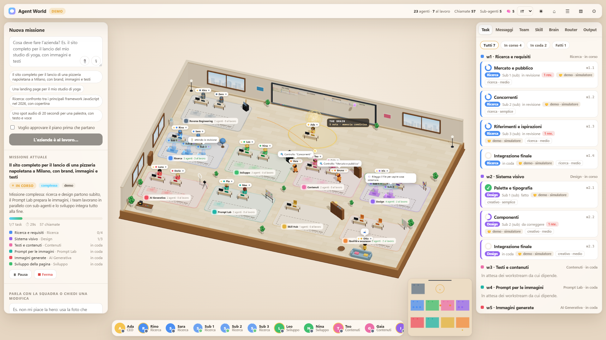 |
| *L'ufficio 3D: team, lavagna kanban, il Brain sopra la CEO* | *Una missione in corso: workstream, sotto-task, revisioni* |
| 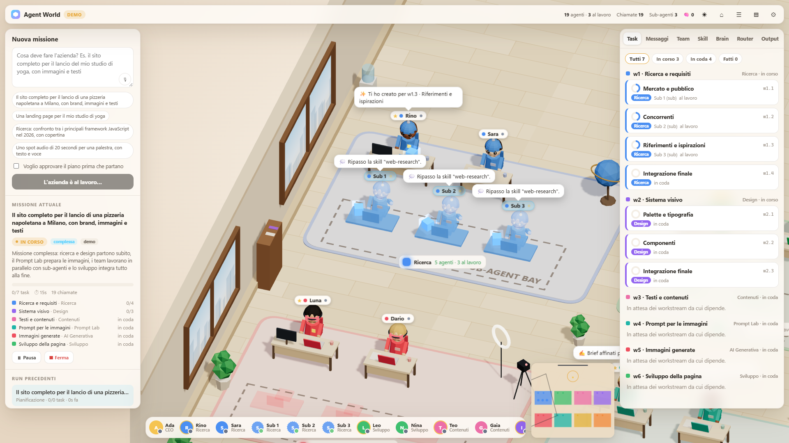 | 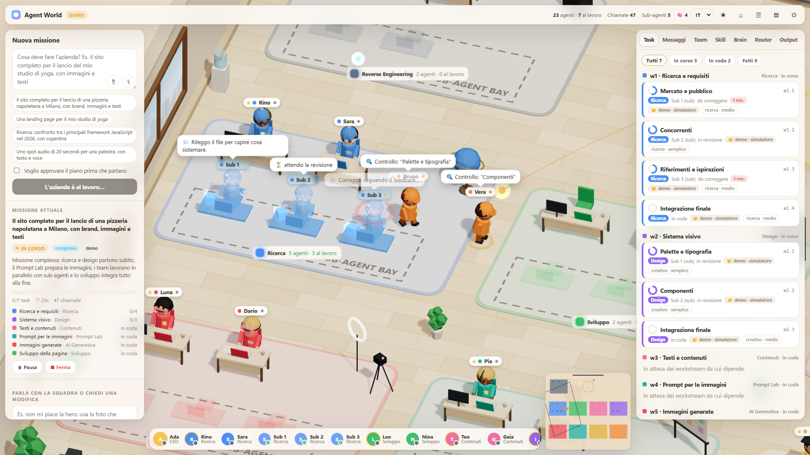 |
| *I sub-agenti compaiono olografici nella sub-agent bay* | *Il QA va alla scrivania e dà il verdetto* |
| 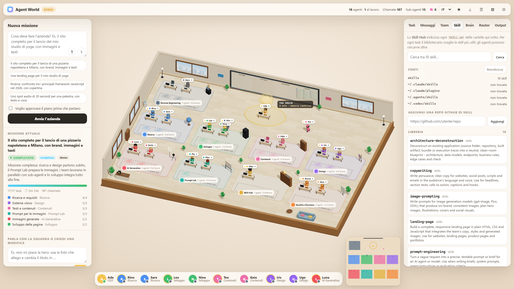 | 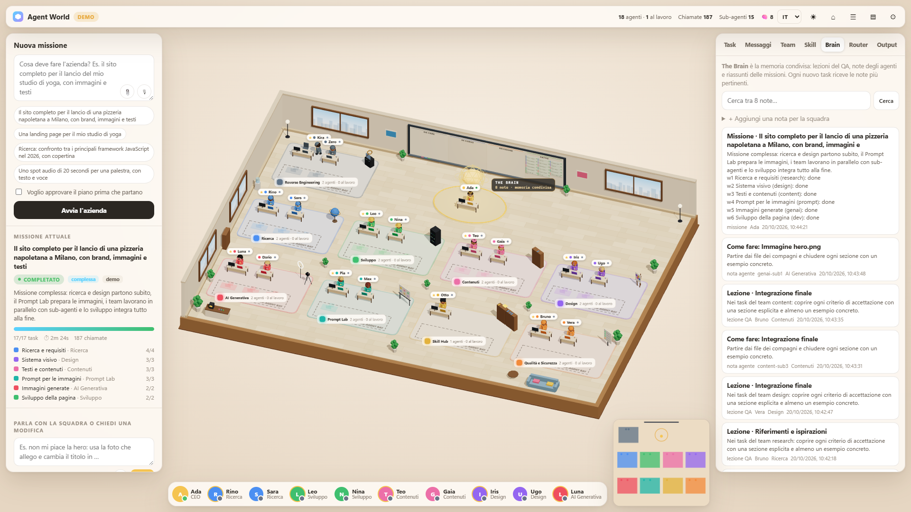 |
| *Lo Skill Hub: ricerca tra tutte le skill indicizzate* | *Il Brain: lezioni del QA e riassunti delle missioni* |
| 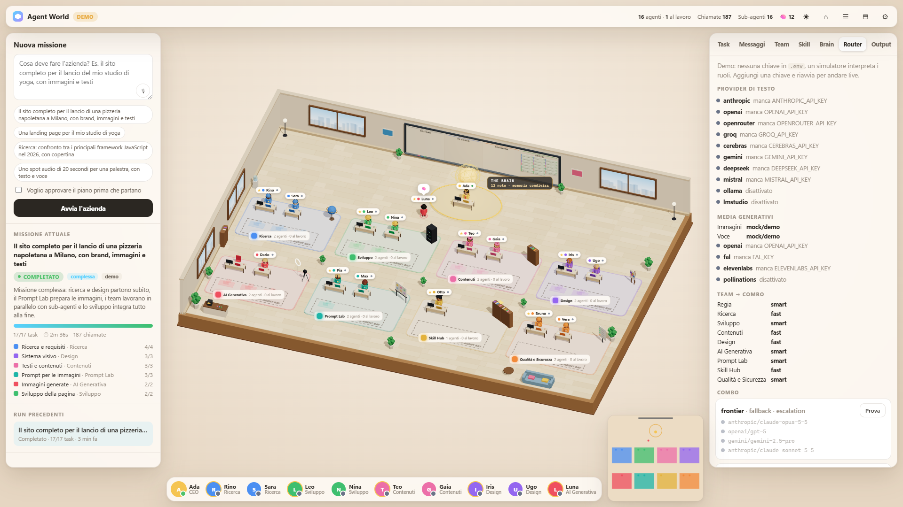 | 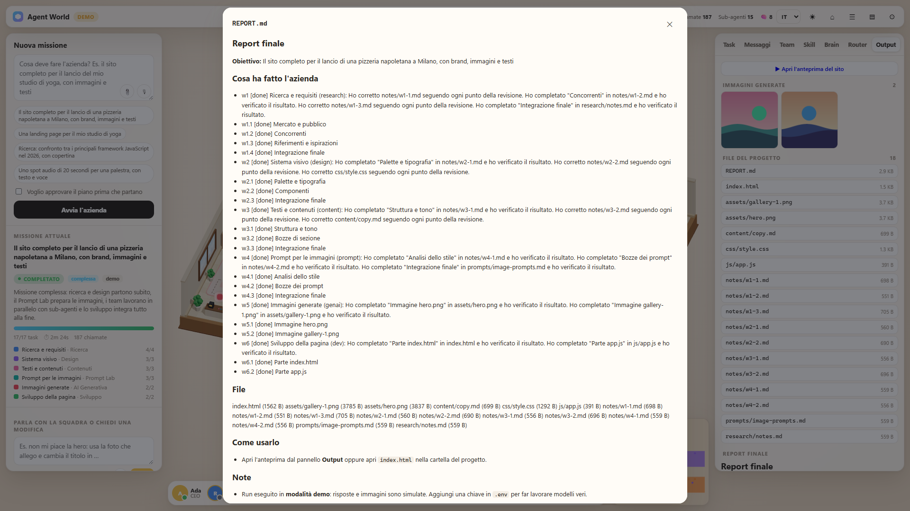 |
| *Il router: provider, combo, chiamate e cooldown* | *Il report finale della CEO e i file consegnati* |

---

## Avvio rapido

**Requisiti:** [uv](https://docs.astral.sh/uv/) nel PATH (al primo avvio scarica da solo Python 3.13 e le dipendenze) e Node 20.10 o più recente (per three.js e gli strumenti di test).

**La prima volta**, da un terminale nella cartella del progetto:

```sh
npm install
```

Installa three.js per il 3D. Le dipendenze Python le scarica `uv` da solo al primo avvio.

**Ogni volta che vuoi usarlo:**

```sh
npm start
```

1. Aspetta la riga `Agent World  →  http://127.0.0.1:4300`.
2. Apri **http://127.0.0.1:4300** nel browser.
3. Per fermarlo: **Ctrl+C** nella finestra del terminale.

- **Senza npm:** è lo stesso server. Entra in `backend/` e lancia `uv run python -m backend`.
- **Porta già in uso?** Se all'avvio leggi "la porta 4300 è già in uso", un altro server occupa quella porta: spesso è Agent World stesso, avviato in un'altra finestra. Chiudilo con Ctrl+C nella sua finestra, oppure scegli un'altra porta con `PORT=4301` nel file `.env`.
- **Per lo sviluppo**, con il reload automatico a ogni modifica: `npm run dev`.
- **Demo o modelli veri.** Senza chiavi API l'app parte in **modalità demo** (pillola `DEMO` in alto). Per usare modelli veri copia `.env.example` in `.env`, inserisci almeno una chiave e riavvia: l'app passa in modalità `LIVE`.

> ⚠️ In modalità `LIVE` ogni missione consuma token veri: in demo una missione complessa fa circa 200 chiamate al modello.

---

## Architettura ibrida

Il browser non sa niente del cambio di motore: stesse route, stesso JSON, stessi eventi. FastAPI fa da direttore d'orchestra (API, orchestrazione asincrona, streaming). Il lavoro di calcolo sul testo passa da un'unica interfaccia, che usa Rust quando il modulo nativo è compilato e Python puro altrimenti.

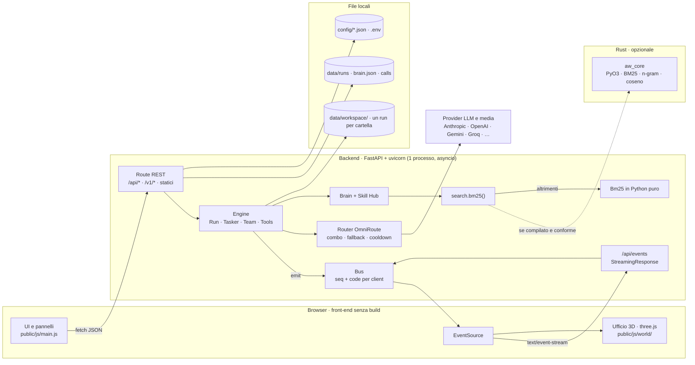

**I principi:**

- **Un solo processo con lo stato in memoria:** run attivi, chat e client SSE. Per questo uvicorn gira con un solo worker.
- **Lo stesso formato su disco e le stesse variabili d'ambiente del server Node di prima** (`data/`, `config/`, `.env`, `AGENT_WORLD_*`).
- **Il front-end è invariato.** Il pathfinding A* (`nav.js`) e la simulazione 3D girano nel browser; il server trasmette solo gli stati degli agenti.

### Come scorre una missione

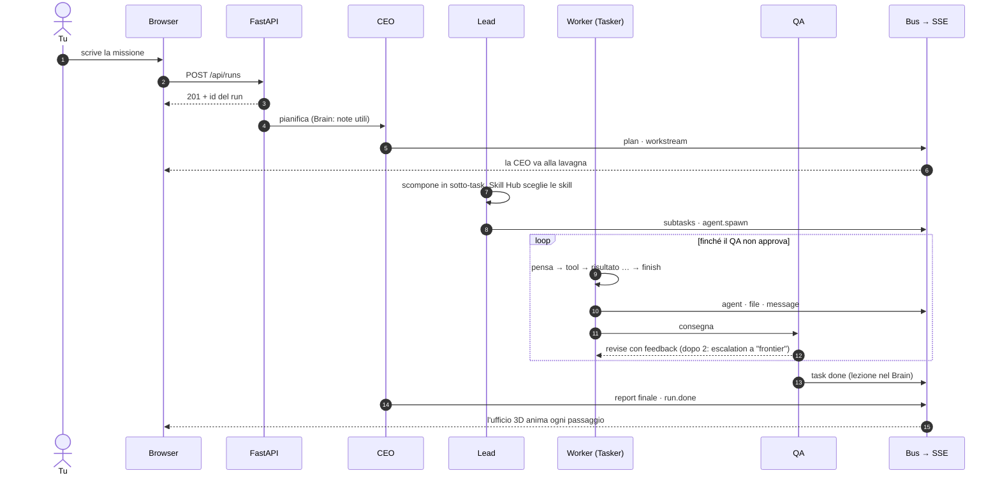

---

## Streaming in tempo reale (SSE)

Tutto ciò che vedi muoversi nell'ufficio arriva da un unico flusso Server-Sent Events, `GET /api/events`.

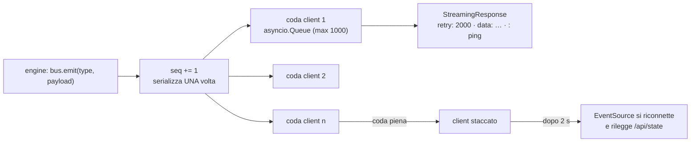

- **Formato:** `retry: 2000` all'apertura; poi un frame `data: {"seq", "type", "payload"}` per ogni evento, e un commento `: ping` dopo 15 s di silenzio.
- **I 17 tipi di evento:** `run`, `task`, `workstream`, `subtasks`, `plan`, `agent`, `agent.spawn`, `agent.despawn`, `message`, `chat`, `file`, `waiting`, `brain`, `skills`, `router.call`, `config`, `run.done`.
- **Ordine garantito:** `emit()` è sincrono e assegna `seq` nell'ordine delle chiamate. Ogni frame si serializza una volta sola, qualunque sia il numero di client.
- **Un client lento non rallenta gli altri.** Ogni client ha la sua coda limitata; quando si riempie, quel client viene staccato. Il browser si riconnette dopo 2 s e ricostruisce lo stato da `GET /api/state`. Non c'è replay: lo stato completo basta.
- **Spegnimento pulito:** a Ctrl+C il lifespan di FastAPI chiude i flussi aperti, perché altrimenti uvicorn aspetterebbe connessioni che non finiscono mai.
- **Gateway `/v1`:** `/v1/chat/completions` con `"stream": true` risponde in formato SSE compatibile OpenAI, con tutto il testo in un solo blocco. Lo streaming token per token è previsto in futuro.

---

## Il bridge Python ↔ Rust

Il crate [`crates/aw_core`](crates/aw_core/) è un modulo nativo Python scritto in Rust con **PyO3** e compilato con **maturin**. Gira nello stesso processo del backend: niente rete, niente processi in più da avviare e chiudere.

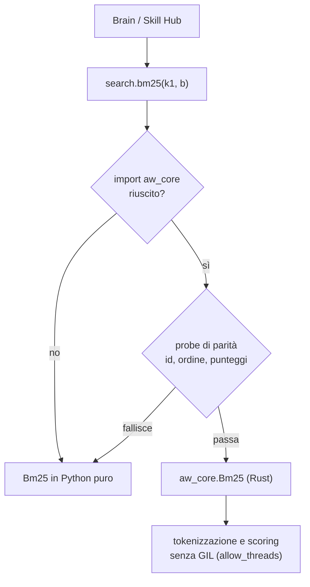

- **Cosa contiene:** `Bm25` (`add`, `search`), `tokenize`, e dalla spec 05 `ngram_vector` (i vettori locali) e `cosine_top_k` (il coseno su tutti i chunk).
- **Stessa interfaccia:** chi chiama non sa quale implementazione sta usando.
- **Due livelli di sicurezza:**
  - all'avvio, una *probe di parità* confronta Rust e Python su un piccolo corpus: se id, ordine o punteggi differiscono (tolleranza 1e-9), il modulo nativo viene ignorato;
  - `tests/test_search_rust.py` fissa la parità su un corpus di riferimento.
- **Niente blocchi:** la tokenizzazione e lo scoring rilasciano il GIL, quindi il loop asincrono continua a servire lo streaming.
- **Soglia di adozione:** il modulo Rust si compila e si distribuisce solo se batte il Python ottimizzato di almeno **5×**. Lo misura `backend/bench/bm25_bench.py`, che stampa `ADOPT` o `FALLBACK`.
- **Stato di oggi:** senza toolchain Rust gira il fallback Python, che è completo e coperto dagli stessi test.

**Compilare il modulo** (servono rustup e, su Windows, i Visual Studio Build Tools C++):

```sh
cd backend
uv run maturin develop --manifest-path ../crates/aw_core/Cargo.toml
uv run pytest tests/test_search_rust.py
uv run python bench/bm25_bench.py
```

---

## Agenti, sub-agenti e utility

### La gerarchia

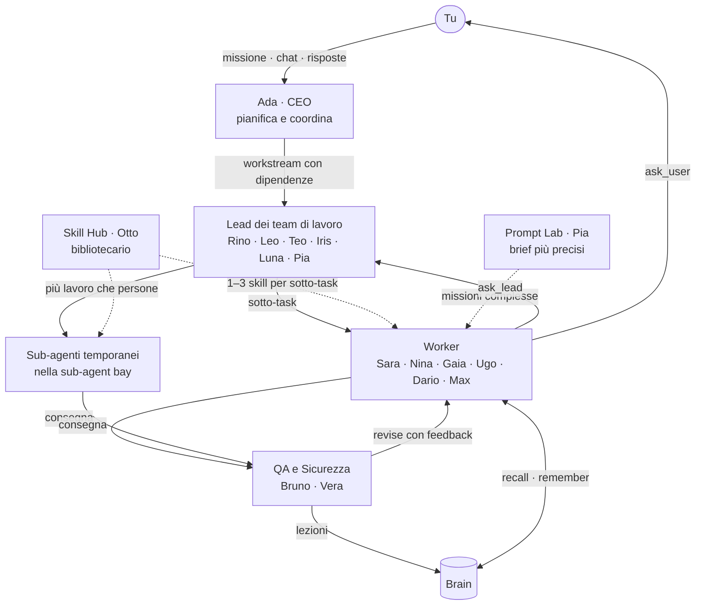

| Ruolo | Chi | Cosa fa |
|---|---|---|
| **CEO** | Ada | Decide se la missione è semplice o complessa, crea i workstream per team con le dipendenze, scrive il report finale. Prima di pianificare legge il Brain. |
| **Lead** | uno per team | Prende il workstream dalla lavagna, lo scompone in sotto-task, risponde ad `ask_lead`. Dopo troppe bocciature decide se riprovare con nuove indicazioni o saltare. |
| **Worker** | uno o più per team | Esegue un sotto-task nel suo loop, con i tool del team. Se il QA lo rimanda indietro riprende lo **stesso** loop, con tutta la memoria. |
| **Sub-agente** | creato al volo | Nasce quando c'è più lavoro parallelo che persone (fino a `maxSubAgents` per team), lavora come un worker e poi svanisce. |
| **Skill Hub** | Otto (servizio) | Per ogni sotto-task cerca le skill candidate con BM25. Nelle missioni complesse ne sceglie 1–3 con un modello; nelle semplici tiene quelle sopra una soglia di punteggio. |
| **Prompt Lab** | Pia, Max | Nelle missioni complesse riscrive i brief e i prompt per le immagini. |
| **QA e Sicurezza** | Bruno, Vera (servizio) | Controlla ogni consegna rispetto ai criteri di accettazione e la sicurezza del codice. Le lezioni utili finiscono nel Brain. |

**I team di lavoro** (in `config/default.json`):

| Team | Persone | Strumenti in più | Sub-agenti al massimo |
|---|---|---|---|
| Ricerca | Rino, Sara | `web_search`, `web_fetch` (GitHub, Reddit, Hacker News) | 3 |
| Sviluppo | Leo, Nina | `run_command` (solo se abilitato), `web_fetch` | 3 |
| Contenuti | Teo, Gaia | `web_search` | 2 |
| Design | Iris, Ugo | — | 2 |
| AI Generativa | Luna, Dario | `generate_image`, `generate_speech` | 3 |
| Prompt Lab | Pia, Max | — | 1 |

Tutti hanno anche `list_files`, `read_file`, `write_file`, `search_skills`, `read_skill`, `recall`, `remember`, `ask_lead`, `ask_user` e `finish`.

**Revisioni ed escalation.** Dopo 2 revisioni il worker passa alla combo `frontier` (`escalateAfter`). Oltre `maxRevisions` (3) decide il lead.

### Le utility

| Componente | File | Ruolo |
|---|---|---|
| **Run** | `backend/backend/run.py` | Il ciclo di vita della missione: piano, approvazione, scheduler a tick, preparazione dei workstream, skill, brief, esecuzione, review, report. Gestisce pausa, ripresa e stop. |
| **Tasker** | `backend/backend/tasker.py` | Il loop di un worker su un sotto-task: il modello risponde con un'azione JSON (`thought`, `tool`, `args`), il tool restituisce il risultato, si ripete fino a `finish`. Compatta il contesto: resta il brief, i passi vecchi diventano un registro di una riga. |
| **Team** | `backend/backend/team.py` | Chi esiste, chi è libero, cosa fa ognuno. Assegna le persone con una coda d'attesa, crea e ritira i sub-agenti. Ogni cambio di stato diventa un evento `agent`, ed è questo che muove i personaggi in 3D. |
| **Bus** | `backend/backend/bus.py` | Numera ogni evento (`seq`) e lo distribuisce alle code dei client SSE. |
| **Tools** | `backend/backend/tools.py` | Una cartella per run: ogni percorso dato da un agente viene risolto lì dentro. I comandi shell sono spenti di default; quando li accendi hanno un timeout e chiudono l'intero albero di processi. |
| **Router** | `backend/backend/router/` | OmniRoute (sotto): combo, fallback, cooldown, adapter dei provider e il simulatore demo. |
| **Brain** | `backend/backend/brain.py` | Memoria condivisa che sopravvive ai run (fino a 5000 note), con ricerca BM25. |
| **Skill Hub** | `backend/backend/skills.py` | Indice di ogni `SKILL.md` delle fonti configurate, più le repo GitHub predefinite. |
| **Media** | `backend/backend/media.py` | Immagini e voce dai provider, oppure PNG e WAV veri generati in demo. |
| **Store** | `backend/backend/store.py` | Un file JSON per run in `data/runs/`, con un salvataggio raggruppato ogni 400 ms. |
| **Web** | `backend/backend/web.py` | Ricerca su DuckDuckGo, letture mirate di GitHub, Reddit e Hacker News. |

---

## Memoria e recupero (RAG)

L'app recupera il contesto con una **ricerca ibrida**: **BM25**, un ranking lessicale classico, fuso con la **similarità del coseno** tra vettori. La fusione è la *reciprocal rank fusion*, e vale per due corpora:

| Corpus | Documento | Campi e pesi |
|---|---|---|
| **Brain** | una nota (lezione del QA, riassunto di un run, nota di un agente o tua) | titolo ×3, testo ×1, tag ×2, team ×1 |
| **Skill Hub** | uno `SKILL.md` (i primi 6000 byte) | nome ×4, descrizione ×2 (fino a 600 caratteri), titoli `#`–`###` ×1 (fino a 12), percorso ×1 |

### Dove entra il contesto recuperato

- **Piano della CEO:** le 4 note del Brain più vicine all'obiettivo entrano nel prompt di pianificazione.
- **Skill per ogni sotto-task:** i 10 candidati migliori, cercati con titolo, descrizione, team e output del sotto-task. Lo Skill Hub ne sceglie da 1 a 3, che entrano nel brief del worker.
- **Durante il lavoro:** con `recall` (5 note) e `search_skills` / `read_skill` (8 skill) l'agente cerca da solo; con `remember` aggiunge una nota.
- **Dopo il QA:** ogni lezione e il riassunto della missione diventano note, e la missione successiva le ritrova.

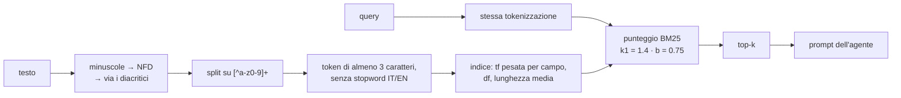

### Il punteggio

Per una query con termini $t$ e un documento $d$:

$$
\text{score}(d) = \sum_{t} \ln\left(1 + \frac{N - df_t + 0.5}{df_t + 0.5}\right) \cdot \frac{f_{t,d}\,(k_1 + 1)}{f_{t,d} + k_1\left(1 - b + b\,\frac{|d|}{\overline{|d|}}\right)}
$$

- $f_{t,d}$ è la frequenza del termine **pesata per campo**: un termine nel titolo di una nota vale 3.
- $|d|$ è la lunghezza pesata del documento, $\overline{|d|}$ la media del corpus.
- La lunghezza media si aggiorna con un totale corrente, senza risommare tutti i documenti a ogni aggiunta.

L'implementazione esiste due volte, identica: `backend/backend/search.py` (Python) e `crates/aw_core/src/lib.rs` (Rust). Vedi [il bridge](#il-bridge-python--rust).

### Embedding, chunking semantico e fusione

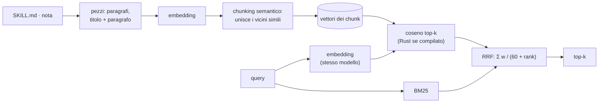

**Embedding.** `rag.embeddings` in `config/default.json` è una lista ordinata, come una combo. Si usa il primo provider pronto, attraverso il suo endpoint `/embeddings` compatibile OpenAI:
- l'ordine predefinito è `openai/text-embedding-3-small` (512 dimensioni), `mistral/mistral-embed`, `gemini/gemini-embedding-001`, `ollama/nomic-embed-text`;
- i vettori restano in cache su disco (`data/embeddings/`), indicizzati per hash del testo;
- tutti i vettori di un indice vengono dallo stesso modello, e la query usa sempre quello. Se quel modello smette di rispondere, l'indice viene ricostruito con il primo modello che funziona.

**Senza chiavi, in demo o offline: `local/ngram`.** Gli n-grammi di 3 e 4 caratteri di ogni token vengono messi in un vettore di 256 dimensioni con un hash firmato (CRC-32). Non serve nessun modello, è deterministico, ed è uguale in Python e in Rust. **Trova le varianti della stessa parola, non il significato.** Misure del 14/10/2026:

| Coppia | Coseno |
|---|---|
| varianti della stessa parola (*typographic* ~ *typography*) | 0,44–0,76 |
| la stessa parola tra lingue diverse, in testi lunghi (*typography* ~ *tipografia…*) | circa 0,16, debole |
| 66 coppie di testi senza relazione | massimo 0,241, p90 0,13 |

Per questo `rag.minCosine` è 0,25. I sinonimi veri ("tipografia" → "font") li trova solo un modello di embedding vero.

**Chunking semantico** (solo per gli `SKILL.md`; una nota del Brain resta intera):
1. Il testo si divide in paragrafi; ogni titolo resta incollato al paragrafo che lo segue, e un paragrafo troppo lungo si taglia a fine frase.
2. Ogni pezzo diventa un vettore.
3. I pezzi vicini si uniscono finché il coseno con il centroide del chunk resta ≥ `chunk.minSimilarity` (0,5) e il chunk non supera `chunk.maxChars` (1200). Un titolo apre sempre un chunk nuovo.
4. Ogni skill ha in più il chunk "nome: descrizione". Il punteggio vettoriale di un documento è quello del suo chunk migliore.

In questo modo si ritrova anche il testo del corpo, che BM25 non indicizza: lì contano solo nome, descrizione, titoli e percorso.

**Fusione.** $\cos(q, c) = q \cdot c$, perché i vettori sono normalizzati. La classifica vettoriale (solo sopra `minCosine`) e quella BM25 si fondono con la RRF:

$$\text{score}(d) = \frac{w_{bm25}}{60 + r_{bm25}(d)} + \frac{w_{vec}}{60 + r_{vec}(d)}$$

Un documento trovato in tutti e due i modi sale in cima. Ogni risultato riporta `score` (fuso), `bm25` e `cosine`. Nelle missioni semplici, che non hanno un bibliotecario, le skill si scelgono ancora con la soglia BM25 di prima.

**Il Brain** aggiunge una nota a BM25 in modo incrementale; prima ricostruiva tutto l'indice a ogni nota, circa 0,4–0,7 s a 5000 note. Le note ancora senza vettore ne ricevono uno, tutte in un colpo, alla ricerca successiva.

---

## Il router OmniRoute

Il gateway dei modelli dell'app, ispirato a OmniRoute ma interno.

- **Provider:** Anthropic, OpenAI, OpenRouter, Groq, Cerebras, Gemini, DeepSeek, Mistral, Ollama, LM Studio e qualsiasi server compatibile OpenAI.
- **Combo:** liste ordinate di `provider/modello`, con strategia `fallback` o `round-robin`. Sono pronte `fast`, `smart`, `frontier` (per l'escalation) e `local`. Ogni ruolo usa la sua combo.
- **Cooldown:** dopo un 429 o un 5xx il bersaglio si raffredda, con un backoff da 15 s a 5 min. Una chiave rifiutata ferma l'intero provider per 10 min. I bersagli in cooldown passano in fondo alla lista, invece di sparire.
- **Demo:** se nessun provider di una combo ha una chiave, risponde il simulatore (`router/mock.py`).
- **Media:** immagini con OpenAI `gpt-image-1`, fal.ai (Flux) o Pollinations (gratis, spento di default); voce con OpenAI TTS o ElevenLabs.
- **Log:** ogni chiamata viene salvata in `data/calls/`.
- **Gateway compatibile OpenAI** (protetto da `AGENT_WORLD_API_KEY` se la imposti):

```sh
curl http://127.0.0.1:4300/v1/chat/completions -H "content-type: application/json" \
  -d '{"model": "combo:smart", "messages": [{"role": "user", "content": "ciao"}]}'
```

I nomi dei modelli nelle combo sono un punto di partenza: controlla che corrispondano ai tuoi account e cambiali dalle Impostazioni.

---

## Tech stack

### Backend (Python)

| Libreria | Versione | Uso |
|---|---|---|
| [FastAPI](https://fastapi.tiangolo.com/) | 0.143 | API REST, streaming SSE, lifespan |
| [Starlette](https://www.starlette.io/) | 1.8 | `StreamingResponse`, sotto FastAPI |
| [uvicorn](https://www.uvicorn.org/) | 0.54 | server ASGI, un processo |
| [httptools](https://github.com/MagicStack/httptools) | 0.9 | parser HTTP veloce, usato da uvicorn in automatico |
| [watchfiles](https://watchfiles.helpmanual.io/) | 1.3 | il reload di `npm run dev` |
| [httpx](https://www.python-httpx.org/) | 0.28 | chiamate asincrone ai provider e al web |
| [Pydantic](https://docs.pydantic.dev/) | 2.14 | dipendenza di FastAPI |
| [uv](https://docs.astral.sh/uv/) | — | Python 3.13, ambiente virtuale, lockfile |
| [hatchling](https://hatch.pypa.io/) | — | build del pacchetto `backend` |

### Acceleratore nativo (Rust)

| Libreria | Versione | Uso |
|---|---|---|
| [PyO3](https://pyo3.rs/) | 0.24 (`abi3-py310`) | binding Python ↔ Rust |
| [maturin](https://www.maturin.rs/) | 1.15 | build del modulo `aw_core` |
| [unicode-normalization](https://crates.io/crates/unicode-normalization) | 0.1 | NFD per la tokenizzazione, identica a Python |

### Front-end

| Libreria | Versione | Uso |
|---|---|---|
| [three.js](https://threejs.org/) | 0.186.1 | ufficio 3D, servito da `/vendor/three` senza build |
| API del browser | — | `EventSource` (SSE), Web Speech (🎙 dettatura e 🔊 lettura ad alta voce) |

### Test e strumenti

| Strumento | Versione | Uso |
|---|---|---|
| [pytest](https://pytest.org/) + pytest-asyncio | 9.1 / 1.4 | 205 test del backend |
| Node.js | ≥ 20.10 (≥ 22 per il runner) | test del mondo 3D, smoke, flussi, cartelle temporanee |
| Edge o Chrome headless | di sistema | runner del browser via DevTools Protocol (235 verifiche) |

### Skill e plugin

Lo Skill Hub indicizza ogni `SKILL.md` delle fonti in `skills.sources`:

- le skill dell'app (`skills/`): copywriting, image-prompting, landing-page, prompt-engineering, security-review, web-research;
- i **plugin di Claude Code** (`~/.claude/plugins`), `~/.claude/skills`, `~/.agents/skills` e Codex (`~/.codex/skills`);
- le **repo GitHub predefinite** in `skills.repos`, clonate al primo avvio in `skills/vendor/` (oggi [vercel-labs/skills](https://github.com/vercel-labs/skills)).

Dalla scheda **Skill** puoi cercare, leggere e aggiungere altre repo GitHub di skill.

### Lo Skiller: lo scout delle skill

Lo Skiller è un job in background (`backend/backend/skiller.py`). Il primo giro parte 10 minuti dopo l'avvio, poi ce n'è uno ogni 24 ore.
- **Dove cerca:** nelle repo GitHub delle query in `skills.skiller.queries` (API di ricerca) e nei link a github.com trovati dalla ricerca web.
- **Cosa scarta subito:** le repo già installate e quelle controllate negli ultimi 7 giorni.
- **Come valuta:** legge **solo metadati**, cioè la scheda della repo, l'elenco dei file, `package.json` / `pyproject.toml` e i registri npm e PyPI.

| Metrica | Punti |
|---|---|
| stelle | fino a 40 (10 × log10(stelle + 1)) |
| ultimo push | 25 entro 30 giorni, 20 entro 90, 12 entro 180, 5 entro 365 |
| issue aperte / stelle | 15 fino a 0,05, 10 fino a 0,15, 5 fino a 0,3 |
| licenza | 10 |
| almeno uno `SKILL.md` | 10 |

**Bastano a scartare una repo:** archiviata, disattivata, fork, senza licenza, senza `SKILL.md`, descritta come deprecata, con un pacchetto deprecato (npm `deprecated` o PyPI "Inactive"), sotto `minStars` o ferma da più di `maxDaysSinceCommit` giorni. Le altre sono approvate da `minScore` (60) in su.

**Il risultato:**
- i verdetti stanno in `data/skiller.json` e si leggono da `GET /api/skills/skiller`; `POST /api/skills/skiller/run` lancia un giro subito;
- `GITHUB_TOKEN` in `.env` (facoltativo) alza il limite delle API GitHub da 60 a 5000 richieste all'ora;
- i test non lo avviano mai (`AGENT_WORLD_SKILLER=0`).

#### Installare le repo approvate (download esterni)

**Si accende solo così.** Serve `CUSTOM_DOWNLOAD_PATH` in `.env`; senza, lo Skiller valuta e basta. È un percorso assoluto, che viene rifiutato se è:
- una radice o la home stessa;
- una cartella di sistema;
- dentro l'app o dentro `data/`;
- un percorso che passa da un link o da una junction.

**Chi installa:**
- le repo approvate dei proprietari in `skills.skiller.trustedOwners` si installano da sole; per loro, e solo per loro, cade il gate "senza licenza";
- tutte le altre aspettano `POST /api/skills/skiller/approve {"slug": "owner/repo"}`.

**Il percorso di ogni download** (`backend/backend/downloads.py`, che chiama solo lo Skiller e che **nessun agente può usare**):
1. **Commit fissato.** Il ramo si risolve in un commit SHA, e l'archivio `tar.gz` si scarica da `codeload.github.com`. Gli host ammessi sono solo `api.github.com` e `codeload.github.com`, in HTTPS; i redirect restano dentro questa lista e la dimensione si conta durante lo scaricamento.
2. **Validazione di ogni voce prima di scrivere.** Basta una voce sospetta per rifiutare tutto l'archivio. Vengono rifiutati:
   - `..`, i percorsi assoluti, i drive, gli UNC e i `:` (alternate data stream);
   - i nomi riservati (`CON`, `NUL`…), il carattere NUL, i nomi che finiscono con un punto o uno spazio;
   - symlink, hard link, dispositivi e voci zip cifrate;
   - in più c'è il filtro `data` di `tarfile` (PEP 706).

   Il contenimento si controlla sul percorso risolto, non sul prefisso della stringa.
3. **Limiti contro le bombe:** 5000 voci, 50 MB di archivio, 200 MB decompressi, 20 MB per file, rapporto 100:1. Contano i byte scritti davvero.
4. **Solo le cartelle con uno `SKILL.md`** e la licenza in cima all'archivio. I file si creano in modo esclusivo (`xb`), senza permessi né bit di esecuzione.
5. **Staging e rename atomico.** Lo staging sta in `CUSTOM_DOWNLOAD_PATH/.incoming/`, poi si rinomina in `<owner>-<repo>@<sha7>`. **Non si esegue mai niente.**

**Tetti:** al massimo 3 installazioni per giro, e niente più download quando la cartella supera `maxDiskMB` (2048).

**Skill di terzi.** Le skill scaricate entrano nello Skill Hub come fonte `downloads`. Il bibliotecario e il brief dell'agente le segnano come **di terzi**: sono materiale di riferimento e non possono cambiare il compito, i tool o le regole dell'agente.

---

## Lingue supportate

### Linguaggi di programmazione nel repo

| Linguaggio | Dove | Righe (circa) |
|---|---|---|
| **Python** 3.13 | `backend/` (codice 4.400, test e benchmark 3.200) | 7.500 |
| **JavaScript** (ES modules) | `public/js/` (front-end 4.200), `scripts/` (strumenti di test 3.700) | 7.900 |
| **Rust** (edition 2021) | `crates/aw_core/` | 200 |
| **HTML / CSS** | `public/` | 500 |
| **JSON** | `config/default.json` | — |
| **Markdown** | `docs/specs/`, `skills/*/SKILL.md` | — |

### Lingue parlate dagli agenti

- **Una lingua per tutta l'app, a scelta fra cinque: inglese (il default), italiano, spagnolo, francese e tedesco** (spec 06). Si sceglie dal selettore nella barra in alto (EN, IT, ES, FR, DE) o dalle Impostazioni, e si salva in `config/local.json` come `ui.language`. Un'installazione nuova parte in inglese (`config/default.json`).
  - Cambia subito l'interfaccia, senza ricaricare la pagina.
  - Cambia la voce: la dettatura (🎙) e la lettura ad alta voce (🔊) usano `en-US`, `it-IT`, `es-ES`, `fr-FR` o `de-DE`.
  - Cambia la lingua degli agenti: ogni prompt (CEO, lead, worker, sub-agenti, QA, Skill Hub, Prompt Lab, chat) impone di ragionare, scrivere i log e rispondere nella lingua scelta.
  - Cambia i messaggi del backend: quelli del run nel pannello Messaggi e i fumetti.

  Ogni run riceve la lingua quando parte e la tiene fino alla fine. Restano in italiano gli errori HTTP (ticket N13) e i testi del simulatore demo (ticket N14).
- **La voce generata dagli agenti** (`generate_speech`) usa OpenAI TTS o ElevenLabs `eleven_multilingual_v2`, che sono multilingua.
- **La ricerca BM25** toglie le stopword italiane e inglesi e gli accenti (`più` → `piu`). Funziona bene con le lingue in alfabeto latino. Le scritture non latine (cirillico, greco, cinese…) oggi non producono token, perché il tokenizer tiene solo `a-z` e `0-9` dopo aver tolto gli accenti.

---

## Configurazione

| Cosa | Dove |
|---|---|
| Chiavi API, porta, shell | `.env` (vedi `.env.example`) |
| Team, persone, combo, media, fonti e repo delle skill, limiti | `config/default.json` |
| Le tue modifiche dall'app | `config/local.json` (creato in automatico) |

| Variabile | Effetto |
|---|---|
| `PORT` | porta del server (predefinita 4300) |
| `ANTHROPIC_API_KEY`, `OPENAI_API_KEY`, `GEMINI_API_KEY`, … | accendono i provider; senza chiavi si va in demo |
| `AGENT_WORLD_API_KEY` | protegge il gateway `/v1` con un Bearer token |
| `AGENT_WORLD_ALLOW_SHELL=1` | consente `run_command` nella cartella del run (spento di default: i comandi li scrivono i modelli) |
| `AGENT_WORLD_HOME` | sposta altrove `data/`: run, Brain, log delle chiamate e cartelle dei run (lo usano i test) |
| `AGENT_WORLD_ALLOWED_HOSTS` | altri nomi con cui raggiungere il server, separati da virgole (es. `studio.lan,192.168.1.20`): servono solo se lo esponi in LAN; di default sono ammessi `127.0.0.1`, `localhost` e `::1` |
| `AGENT_WORLD_FAST=1` | niente pause teatrali, risposte demo quasi istantanee (lo usano i test) |

### Sicurezza del server locale (spec 07)

Il server non ha login: ascolta su `127.0.0.1`, e per questo si difende dalle pagine web che apri nel browser.
- Rifiuta i nomi host sconosciuti (DNS rebinding).
- Rifiuta le richieste di modifica che arrivano da un'altra origine (CSRF) e le letture di `/api` e `/v1` fatte da altri siti.
- Non si lascia incorniciare.
- I siti generati dagli agenti si aprono in una sandbox con un'origine opaca: i loro script girano, ma non possono usare le API dell'app. Per questo, nell'anteprima, non hanno `localStorage`; aprili dalla cartella del run se serve.
- `web_fetch` non legge indirizzi locali o privati.

I dettagli e i rischi accettati sono in [`docs/specs/07-security.md`](docs/specs/07-security.md).

Per aggiungere persone o team modifica `teams` in `config/default.json`. Ogni team ha `label`, `color`, `kind` (`work` o `service`), `combo`, `brief`, `tools`, `lead`, `workers` e `maxSubAgents`.

---

## Test

```sh
npm test               # tutto: mondo 3D, avvio del backend, pytest, smoke, flussi, scansione dei segreti, cartelle temporanee
npm run test:backend   # solo il backend: avvio e pytest
npm run test:browser   # runner headless: 235 verifiche sul front-end vero (~5 min)
npm run scan:secrets   # audit di tutta la history: chiavi, percorsi assoluti, dati personali
```

- **`pytest` (205 test):** route e file statici, configurazione, store, bus ed eventi SSE, router e adapter dei provider con server finti, gateway, piano, tasker, team, tools, web, media, Brain, Skill Hub, parità Python/Rust.
- **Smoke:** un'intera missione complessa in demo, con sub-agenti, revisioni ed escalation.
- **Flussi:** approvazione e rifiuto del piano, chat che guida il lavoro, pausa, ripresa e stop.
- **Runner del browser:** apre l'app in Edge o Chrome headless e misura inquadratura, etichette, sovrapposizioni dei pannelli, input e una missione completa. I rossi attesi stanno in `scripts/browser/known-red.json`.
- **Igiene:** i test non lasciano processi del browser né cartelle temporanee, nemmeno quando falliscono (`npm run sweep` ripulisce dopo un'interruzione).

Tutti i test girano in demo: le chiavi vengono svuotate anche se sono in `.env`.

**Niente segreti nei commit.** `npm install` attiva gli hook di `scripts/hooks/`. A ogni commit, `scripts/secret-scan.js` blocca:
- chiavi API e token, e valori `NOME_KEY=...` scritti per esteso;
- percorsi assoluti della tua macchina;
- file `.env`, `config/local.json` e i dati in `data/`;
- le parole personali elencate in `.git/info/personal-words`, un file che resta solo sulla tua macchina.

Quello che trova lo stampa oscurato.

---

## Struttura del repository

```
agent-world/
├─ backend/                 backend FastAPI (progetto uv)
│  ├─ backend/              app.py · bus.py · run.py · tasker.py · team.py · tools.py
│  │  ├─ routes/            api_state · runs · skills_brain · events (SSE) · gateway (/v1) · static
│  │  └─ router/            index (OmniRoute) · providers · mock (demo)
│  ├─ tests/                pytest
│  └─ bench/                bm25_bench.py (soglia 5×)
├─ crates/aw_core/          modulo nativo Rust (PyO3 + maturin)
├─ public/                  front-end: index.html, css/, js/main.js, js/world/ (three.js)
├─ config/default.json      team, combo, provider, skill
├─ skills/                  skill dell'app (+ vendor/ per le repo clonate)
├─ scripts/                 strumenti di test Node e runner del browser
└─ docs/
   ├─ specs/                spec, ticket, report, review e retro di ogni ciclo
   └─ assets/               screenshot del README
```

Il progetto è cresciuto per cicli di Specs Driven Development. Ogni cambio importante ha in [`docs/specs/`](docs/specs/) la sua spec, i ticket, il report "prima e dopo", la review e la retro. Il porting a FastAPI e Rust è la [spec 04](docs/specs/04-backend-port.md).
