# Report — Spec 01, inquadratura dell'ufficio v3 e cubi

## Prima (T0, 2026-10-12, codice al commit `c1312ff`)

### Condizioni

- Server demo sulla porta 4310, con `AGENT_WORLD_HOME` in una cartella temporanea. Nessuna chiave API: modalità DEMO confermata dal log e dalla pill in alto.
- Pannello browser dell'app Claude, con viewport emulato (1920×1080, 2560×1440, 1440×900) e devicePixelRatio 1,25.
- Il pannello è largo solo 476 px, quindi gli screenshot dei viewport emulati escono ridotti di circa 4 volte e non sono leggibili. Per questo **le verifiche sono numeriche**: snippet in console che proiettano la scena con la camera reale e la confrontano con i rettangoli del DOM.

### Inquadratura

Snippet `__cov()`: griglia del pavimento a passo 0,5 proiettata con `agentWorld.camera`. Un punto conta come coperto se cade sotto `.topbar`, `#left`, `#right`, `#roster` o `#minimap`, oppure fuori dallo schermo. Per le zone si proietta la loro area a y = 1 e la topbar non viene contata.

| Viewport | Pannelli | Pavimento coperto | Di cui | Zone coperte (%) | Larghezza dell'ufficio |
|---|---|---|---|---|---|
| 1920×1080 | LR | **21%** | sinistro 7%, destro 11%, minimappa 2% | research 17 · design 44 · genai 51 · qa 15 | 1774 px |
| 1920×1080 | -R | 14% | destro 11%, minimappa 2% | design 44 · qa 15 | 1774 px |
| 1920×1080 | -- | 0% | — | — | 1774 px |
| 2560×1440 | LR | 10% | sinistro 3%, destro 5%, minimappa 1% | design 12 · genai 24 | 2366 px |
| 2560×1440 | -R | 6% | destro 5%, minimappa 1% | design 12 | 2366 px |
| 2560×1440 | -- | 0% | — | — | 2366 px |
| 1440×900 | LR | **38%** | sinistro 15%, destro 21%, minimappa 2% | research 53 · design 88 · genai 86 · qa 54 | 1331 px |
| 1440×900 | -R | 23% | destro 21%, minimappa 2% | design 88 · qa 54 | 1331 px |
| 1440×900 | -- | 0% | — | — | 1331 px |

I valori coincidono al punto percentuale con la stima in Node della spec (tabella 1.1). Lo stesso snippet servirà in T5 e T8.

### Cubi: stress R1–R4

Snippet `__cubeStress()`, salvato come `cube-stress.js` nella cartella temporanea della sessione e da rilanciare in T2 e T8. Chiama direttamente i metodi della `World` per forzare le sequenze; dopo ogni caso controlla gli orfani e ripulisce.

| Caso | Esito | Dettaglio |
|---|---|---|
| R1: lo split viene superato dal volo verso la mano | ✖ | Il cubo di `nina` resta a `(-9.9, 1.0, -2.8)` in coordinate locali, a circa 10 unità dal personaggio |
| R2: pickup ancora in volo quando arriva lo split | ✖ | `teo` porta il cubo grande del workstream, ormai eliminato |
| R3: consegna o affondamento durante il volo verso la mano | ✖ | `ugo` porta il cubo consegnato a `(0, 3, -16.9)` in coordinate locali (le coordinate della lavagna applicate nello spazio del personaggio); `dario` porta il cubo affondato |
| R4: reset del run durante il volo | ✖ | `vera` porta un cubo del run precedente |

### Run completo

- **Missione:** "Il sito completo per il lancio di una pizzeria napoletana a Milano, con brand, immagini e testi", a 1920×1080 con entrambi i pannelli, ritmo normale.
- **Esito:** `completed`, con 6 workstream, 17 task (tutti `done`), 2 sub-agenti creati e rimossi, 23 verdetti del QA (17 promossi, 6 da rivedere).
- **Sonda:** controlli ogni 250 ms sugli orfani dei cubi e sulla posizione dei sub-agenti, più l'aggancio a `applyState` e `bubble` per i verdetti.

| Verifica | Esito |
|---|---|
| Il verdetto del QA compare solo con il revisore alla scrivania | ✔. Il fumetto compare sempre con il revisore a 1,0–1,1 dal destinatario (posto accanto alla sedia), con un ritardo massimo di 1,04 s dall'evento. `yieldTo()` funziona come previsto. |
| I sub-agenti lavorano nella bay | ✔. `research-sub1` e `prompt-sub1` restano entro 1,6 dal proprio posto nella bay mentre sono occupati; il massimo corrisponde alla camminata verso la scrivania del lead per prendere il cubo. |
| Cubi | ✖. **R1 si è verificato anche nel run reale**: `research-sub1` aveva il cubo a `(-20.93, 0.95, -2.82)` in coordinate locali, cioè la posizione della scrivania del lead di research applicata nello spazio del personaggio. Il cubo è rimasto staccato dalla mano finché il sub-agente è stato rimosso. A fine run: 0 cubi rimasti, nessun personaggio con `carrying`. |
| Ciclo di vita, carte e consegne | ✔. 6 pickup, 6 split, 17 prese, 17 consegne, 23 drop; nessun cubo vagante a fine run. |

### Difetto nuovo N1: effetti persi dentro `Fx.update`

`Fx.update()` esegue `this.items = this.items.filter(...)`. Un effetto creato **durante** l'aggiornamento di un altro effetto viene aggiunto con `push` all'array vecchio, che subito dopo viene sostituito. L'effetto non viene mai aggiornato né eliminato, ma le sue mesh sono già nella scena: restano lì congelate per sempre.

Casi concreti:
- l'anello d'arrivo di ogni fascio di luce (`beam` chiama `ring` all'arrivo);
- le scintille sulla carta a ogni consegna (`done` di `deliverCube` chiama `sparkle`).

A fine run, con 0 effetti attivi, la scena conteneva **144 anelli** (`RingGeometry`, scala 1, opacità 0,8) e **170 ottaedri** (17 scintille da 10 particelle, una per consegna). Si accumulano tra un run e l'altro, perché `resetRun` non li tocca.

**Valutazione del perimetro:**
- è un difetto dello stesso ciclo di `Fx` che T1 riscrive;
- le garanzie di S4.1 (`track`/`stop`, `done` mai chiamato dopo l'annullamento) valgono solo se il ciclo regge l'aggiunta di effetti durante l'aggiornamento: un `fly` avviato dentro un `done` oggi andrebbe perso, e la mappa di `track` punterebbe a un effetto morto.

Per questo lo includo in T1 come aggiunta **S4.5** alla spec, con un test dedicato in A5.

### Cosa resta da osservare a schermo

Gli screenshot leggibili richiedono un pannello browser più largo. Le verifiche numeriche coprono i criteri della spec. Una conferma visiva da parte dell'utente su un monitor a 1920×1080 resta utile in T8.

## Verifiche per ticket

### T1 — `Fx` (commit `a64d8b2`)

- `scripts/world-test.js`: 6 controlli verdi, tra cui il caso degli effetti annidati di N1 e i voli concatenati sullo stesso oggetto. La suite parte per prima in `npm test`.
- Controprova sull'`Fx` precedente: nello stesso scenario restavano 11 mesh nella scena (un anello e 10 scintille) e un volo annullato chiamava comunque `done`. Con la versione nuova: 0 e 0.
- `npm test` completo verde.

### T2 — Cubi

**Stress A9**, con lo snippet `__cubeStress()` reso deterministico: la `World` avanza a 60 fps fissi chiamando `frame()`, così il risultato non dipende dal ritmo del browser. Il pannello nascosto gira a 0,7–2 fps.

| Caso | Solo T1 (vecchio `world.js`) | T1 + T2 |
|---|---|---|
| R1: lo split viene superato dalla presa | ✔ (il volo nuovo sostituisce il vecchio) | ✔ cubo in mano |
| R2: pickup in volo, poi split | ✖ `teo` porta il cubo grande eliminato | ✔ split rimandato ed eseguito |
| R3: consegna o affondamento durante la presa | ✖ solo l'affondamento: `dario` porta il cubo affondato | ✔ |
| R4: reset durante la presa | ✖ `vera` porta un cubo del run precedente | ✔ |
| R5: seconda presa con un cubo già in mano | ✖ il primo cubo resta attaccato al personaggio | ✔ il primo va sulla scrivania, il secondo in mano |

**Run completo** con T1 + T2: stessa missione di T0, simulazione a velocità reale. Il rendering è spento durante la pompa, perché il pannello nascosto non disegna.

| Verifica | T0 | T1 + T2 |
|---|---|---|
| Esito | `completed`, 6 workstream, 17/17 task | identico |
| Cubi: pickup, split, prese, consegne, drop | 6 / 6 / 17 / 17 / 23 | 6 / 6 / 17 / 17 / 23 |
| Anomalie dei cubi durante il run | 1 (R1, `research-sub1`) | **0** |
| Cubi rimasti a fine run | 0 | 0 |
| Effetti congelati a fine run (anelli / ottaedri) | 144 / 170 | **0 / 0** |
| Verdetti con il revisore alla scrivania | 23/23 (distanza 1,0–1,1) | 23/23 (distanza 1,0–1,1) |

`npm test` completo verde. `node --check` verde su `world.js` e `fx.js`.

### Difetto N2: il client resta indietro quando la scheda è nascosta (osservato, fuori perimetro)

È un difetto preesistente e non è stato corretto. Il rendering si ferma a pannello o scheda nascosti (bug noto in HANDOFF). Gli eventi del server invece arrivano in tempo reale, quindi le code di azioni dei personaggi si allungano. In un run fatto a 0,7 fps sono comparsi due effetti:
- **cubi che affondano invece di essere consegnati:** lo stato `idle` arriva mentre la consegna è ancora in coda dietro la camminata, e `applyState` (ramo `idle`) affonda il cubo;
- **un cubo lasciato su una scrivania a fine run** (`w1.3` dal lead `rino`): `onDespawn` rimuove il sub-agente con un `setTimeout` di 800 ms (tempo reale) prima che la sua coda arrivi alla presa del cubo.

A velocità reale non succede (0 affondamenti, 0 cubi rimasti). Lo propongo come ticket separato dopo questa spec, per esempio con il recupero del ritardo al ritorno visibile e la rimozione del sub-agente legata alla fine della sua coda.

### T3 — `framing.js` ed `ENVELOPE`

**Correzione di S2.1.** Sotto il pavimento c'è la base del diorama: un blocco alto 1,6 più un plinto, fino a `y = -1.66`, che sporge di 0,65 oltre il bordo. La sua faccia anteriore è visibile dalla camera, e i 7 punti della prima versione della spec la ignoravano. Con i pannelli chiusi, quando l'altezza è l'asse più stretto, il fondo della base sarebbe finito sotto il roster:

| Viewport | Pannelli | Fondo della base con l'ingombro a 7 punti | Con `ENVELOPE` (11 punti) |
|---|---|---|---|
| 1920×1080 | -R | 6 px sotto l'area libera | dentro |
| 1920×1080 | -- | 20 px sotto l'area libera | dentro |
| 1440×900 | -- | 16 px sotto l'area libera | dentro |
| 1920×1080 | LR | dentro (è la larghezza a vincolare) | dentro |

**Larghezza dell'ufficio con la nuova inquadratura** (calcolata, da verificare a schermo in T5):

| Viewport | LR | -R | -- |
|---|---|---|---|
| 1920×1080 | 1098 px (scala 0,61 di oggi) | 1422 px (0,79) | 1422 px (0,79) |
| 1440×900 | 637 px (0,35) | 965 px (0,54) | 1148 px (0,64) |

**Test** (`world-test.js`, suite `framing`):
- A1 su 20 layout (5 risoluzioni × 4 combinazioni di pannelli): tutto l'ingombro dentro l'area libera, centrato (±2 px), il 96,2% dell'asse più stretto occupato (margine 4%), target sul pavimento, angolo di camera invariato;
- A2 a zoom 0,5, 1, 2,2 e 4: il target resta al centro dell'area libera (±1 px);
- A3: lo spostamento usato da `OrbitControls` per il pan coincide con la dimensione reale di un pixel, e 100 px di trascinamento spostano l'immagine di 100 px (±1e-6), con la lente attiva;
- A4: sotto la soglia minima gli ingombri vengono ignorati, e le dimensioni nulle non producono NaN.

**Prova che i test colgono gli errori**, con due errori introdotti apposta in `framing.js`:
- con il segno della lente invertito fallisce "inside the free area";
- senza riportare il target sul pavimento fallisce "target on the floor".

Il modulo non è ancora collegato alla `World`: nessun cambiamento visibile fino a T5.

### T4 — Un'unica animazione della camera

**Cosa cambia:**
- `moveCamera({ target, offset, zoom, duration })` è registrata con `fx.track(this.camera)` e anima insieme target, orbita e zoom (0,7 s, rallentamento cubico come prima). `panTo`, `focus` e `focusRoom` la usano: il focus ora è un'unica animazione invece di due.
- **Scelta che conserva il comportamento di oggi:** un movimento nuovo parte da dove si trova la camera, e i valori che non imposta continuano verso la meta del movimento che sostituisce. Oggi un clic sulla minimappa durante un focus sposta la vista ma lascia finire lo zoom a 2,2; con uno slot unico "ingenuo" lo zoom si sarebbe fermato a metà.
- **L'orbita gira per la via breve**, in coordinate sferiche: il raggio resta costante e un offset invariato viene copiato esatto, senza errori di arrotondamento. Nessun chiamante la usa ancora; servirà a ⌂ in T5.
- `resetView()` ferma l'animazione in corso. **Bug preesistente corretto:** ⌂ premuto durante un focus veniva annullato dal focus, che continuava e riportava la camera sull'agente.
- `Fx.active(obj)` restituisce l'animazione attiva di un oggetto, così la `World` legge la meta corrente senza toccare le strutture interne di `Fx`.

**Equivalenza** con lo snippet `__camTest()`, che fa avanzare la `World` a 60 fps fissi e confronta vecchio e nuovo `world.js` nelle stesse condizioni:

| Scenario | Vecchio | Nuovo |
|---|---|---|
| Focus su un agente | ✔ zoom 2,2, salto massimo per frame 0,701 | ✔ identico |
| Focus su una stanza | ✔ zoom 2 | ✔ identico |
| Pan dalla minimappa | ✔ zoom e orbita invariati | ✔ identico |
| Focus su A, poi su B a metà | ✔ salto massimo 0,701, zoom mai in calo | ✔ identico |
| Pan dalla minimappa durante un focus | ✔ finisce a zoom 2,2, salto massimo 1,331 | ✔ identico |
| ⌂ durante un focus | ✖ finisce sulla CEO a zoom 2,2 | ✔ vista iniziale, zoom 1 |

**Rotazione dell'orbita** (nuova, misurata dal secondo frame in poi):
- da 170° a -170° la camera percorre +18,6°, cioè +20° per la via breve, di cui il primo frame non registrato copre circa il 7%;
- il raggio resta costante a 62,05;
- l'offset finale è esatto (errore circa 1e-14).

`world-test.js` controlla anche `Fx.active`. `npm test` è verde.

### T5 — Inquadratura collegata ai pannelli

**Cosa cambia:**
- **`main.js`:** `measureInsets()` legge topbar, pannelli e roster; un solo `ResizeObserver` li osserva e chiama `world.setInsets()`. Scatta anche quando un pannello viene nascosto, perché la sua dimensione scende a 0. Sotto i 900 px i pannelli non contano. ⌂ chiama `resetView({ animate: true })`.
- **`world.js`:**
  - `resetView()` usa `fitOffice()` e `moveCamera()`;
  - `moveCamera()` anima anche la proiezione (scala e spostamento) insieme a target, orbita e zoom;
  - ogni passo dell'animazione fa il proprio `lookAt`, così l'orientamento non è in ritardo di un frame rispetto ai controlli;
  - prima di ogni movimento, `settleControls()` esaurisce l'inerzia rimasta da un trascinamento.

**Scelte contro gli sfarfallii:**
- **Fit e ridisegno subito, dentro il `ResizeObserver`.** `renderer.setSize()` svuota il canvas dopo che il frame è già stato disegnato, e il browser esegue quei callback prima di dipingere: rimandare il fit al frame dopo, come prevedeva la prima versione del ticket, avrebbe mostrato un frame vuoto o deformato. Per lo stesso motivo anche la prima applicazione dei pannelli, al caricamento, ridisegna subito. S3.6 e il ticket sono aggiornati.
- **Scala animata direttamente invece del trucco sullo zoom.** `OrbitControls.update()` riporta lo zoom dentro [0,5, 4] a ogni frame (riga 895 di r186). Animare lo zoom fino a `vecchia / nuova` scala si sarebbe potuto scontrare con quel limite.

**Verifiche nel browser** (viewport emulato, misure numeriche):

| Verifica | Esito |
|---|---|
| A1: pavimento coperto con i layout LR, -R e -- | **0%** a 1920×1080, 2560×1440 e 1440×900 (prima: 21/14/0, 10/6/0, 38/23/0). Nessuno degli 11 punti dell'ingombro sotto l'interfaccia. |
| A1 su schermo stretto (800×600) | 0%; i pannelli sono ignorati, l'ufficio sta tra topbar e roster |
| Larghezza dell'ufficio a 1920×1080 | LR 1098 px, -R 1403 px, -- 1419 px |
| A6: apertura e chiusura dei pannelli | salto al momento del clic: **0 px**; animazione di 0,35 s esatti; larghezza monotona (1098 → 1403 e ritorno); finisce sul fit esatto |
| Ridimensionamento a 1600×900 | subito dopo il resize, aspetto della proiezione = aspetto del canvas, buffer di disegno aggiornato, vista già sul fit |
| A3: pan | 100 px di trascinamento = 100 px sullo schermo (calcolo di `OrbitControls` contro la proiezione reale) |
| Target al centro dell'area libera | scarto (0, 0) px |
| Click sugli agenti con lo spostamento della proiezione | 16/16 |
| ⌂ dopo un focus | animazione di 0,6 s fino al fit |
| Scenari di T4 | 6/6 ok (lo scenario 6 ora finisce sul fit) |
| Errori in console | nessuno nuovo dopo il ricaricamento |

**Limiti noti fino ai ticket successivi:**
- **Fino a T6** non c'è la modalità manuale: dopo un trascinamento, aprire o chiudere un pannello o ridimensionare la finestra ricentra comunque la vista.
- **Fino a T7:**
  - etichette e primi piani sono ancora relativi al fit, quindi con i pannelli aperti le etichette sembrano più grandi rispetto all'ufficio e il focus è meno ravvicinato di prima;
  - nella minimappa l'impronta della camera copre tutto il canvas.

### T6 — Modalità automatica e manuale

**Cosa cambia** (solo `world.js`):
- `autoFrame` parte `true`. In modalità manuale `setInsets()` salva gli ingombri senza muovere la camera, e `resize()` applica solo `applyView()`: scala, lente, target e zoom restano quelli di prima. `resetView()`, cioè ⌂, rimette la modalità automatica.
- `focus()`, `focusRoom()` e il clic sulla minimappa passano a manuale. Il loro movimento **sostituisce** quello in corso senza fermarlo prima, così ne eredita la meta non ancora raggiunta: per esempio la proiezione di un riadattamento a metà.
- Un trascinamento, un pinch o la rotella passano a manuale e fermano l'animazione della camera (S4.4).

**Come si riconosce il controllo manuale.** Le regole sono ricavate dai sorgenti di `OrbitControls` e `MapControls` r186:
- **Ordine degli ascoltatori.** I controlli registrano `pointerdown` e `wheel` sul canvas alla loro creazione, quindi prima dei nostri. `pointermove` e `pointerup` invece li registrano sul documento, quindi dopo i nostri. Il primo puntatore viene catturato dal canvas: i nostri ascoltatori vedono tutto il gesto, anche fuori dal canvas.
- **Trascinamento.** Un puntatore che si allontana di almeno 5 px dal punto in cui è sceso (la stessa soglia del clic: 4,9 px è un clic, 5 px un trascinamento), mentre `controls.state !== -1`. `state` è una proprietà pubblica e documentata di `Controls`, e -1 significa "nessun gesto". Copre pan (sinistro), rotazione (destro, o sinistro con un modificatore), dolly (centrale) e pan touch. Esclude i tasti che i controlli ignorano.
- **Pinch.** Due puntatori la cui distanza cambia di almeno 5 px, anche se ogni dito si muove di meno: in un pinch simmetrico bastano 3 px per dito.
- **Rotella.** Contano solo gli scatti che i controlli usano davvero. Chiamano `preventDefault()` solo dopo i loro controlli (abilitati, zoom attivo, nessun trascinamento in corso), quindi basta leggere `defaultPrevented`. Serve anche `deltaY ≠ 0`: uno scorrimento solo orizzontale non zooma. Il pinch del trackpad arriva come rotella con `ctrlKey` ed è coperto.
- **Clic.** Ora è valutato per puntatore. Un gesto con due puntatori non è mai un clic, come già succedeva prima con l'unica variabile `down`: un tocco con due dita non selezionava nulla.
- **Difesa.** Una pressione chiusa da `pointercancel`, o il cui rilascio non è arrivato al canvas (un `pointermove` senza tasti premuti), viene scartata e non resta "appesa".

**Due difetti trovati durante l'implementazione e corretti nel perimetro** (spec aggiornata):
- **S3.7, centratura in modalità manuale.** Senza una regola, dopo l'apertura di un pannello in modalità manuale la lente resta quella degli ingombri vecchi, e un focus centrava l'agente fuori dal centro dell'area visibile: 206 px con il pannello destro a 1920×1080. Ora `focus`, `focusRoom` e la minimappa passano a `moveCamera` la lente dell'area libera attuale (`centreLens()`), e `moveCamera` accetta una `view` parziale. In modalità automatica non cambia nulla, perché la lente è già quella.
- **N3 → S4.6, salto dopo un clic durante un movimento.** `MapControls` fa il pan "verso il punto afferrato": a ogni `pointermove` ricalcola lo spostamento che riporta sotto il cursore il punto del mondo catturato al `pointerdown`. Se un'animazione sposta la vista sotto una pressione, anche 1 px di tremolio produce uno spostamento pari a tutto il tragitto dell'animazione. `settleControls()` (T5) lo applicava di colpo al movimento successivo. Misure a 1920×1080, con il codice di T5:
  - un clic su un altro agente durante un focus faceva saltare la camera di 47,6 px (pressione di 0,05 s) e di 134,2 px (0,15 s);
  - un clic sul pavimento lasciava una deriva di 1,7–4,4 px dopo la fine del movimento.

  Ora la spinta residua viene **scartata**: si salva la camera, `update()` senza smorzamento consuma e azzera i residui, poi la camera viene ripristinata. Succede all'inizio e alla fine naturale di ogni movimento. Risultato: 0 e 0.

**Verifica A7.** Lo snippet `__a7()` in console fa questo:
- invia eventi sintetici di puntatore e rotella sul canvas. La cattura del puntatore è sostituita da una funzione vuota, perché il browser la rifiuta per i puntatori sintetici;
- usa i veri pulsanti dei pannelli e misura gli ingombri come `main.js`;
- fa avanzare la `World` a 60 fps fissi con il disegno sospeso, perché il pannello nascosto non disegna frame.

La misura è lo spostamento massimo, in px sullo schermo, dei 4 angoli del pavimento e del target prima e dopo la chiusura e la riapertura del pannello destro. Prima della misura l'inerzia del trascinamento si esaurisce per 3 s (0,92¹⁸⁰ ≈ 3e-7). Lo stesso snippet gira sul `world.js` di T5 e su quello nuovo:

| Caso | T5 | T6 |
|---|---|---|
| Trascinamento (pan) | la vista si sposta di 214 px | manuale, 0 px |
| Rotazione (tasto destro) | 836 px | manuale, 0 px |
| Dolly (tasto centrale) | 376 px | manuale, 0 px |
| Trascinamento di 5 px esatti | 386 px | manuale, 0 px |
| Trascinamento di andata e ritorno | 391 px | manuale, 0 px |
| Rotella | 364 px | manuale, 0 px |
| Pinch del trackpad (ctrl + rotella) | 398 px | manuale, 0 px |
| Pinch touch, 3 px per dito | 375 px | manuale, 0 px |
| Clic su un agente | 833 px | manuale, 0 px |
| Clic sull'etichetta di una stanza | 737 px | manuale, 0 px |
| Clic sulla minimappa | 259 px | manuale, 0 px |
| Clic sul pavimento con 2 px di tremolio | si riadatta | resta automatica, si riadatta |
| Trascinamento di 4,9 px | si riadatta | resta automatica, si riadatta |
| Rotella solo orizzontale (`deltaY` 0) | si riadatta | resta automatica, si riadatta |
| Rotella con un tasto premuto (i controlli la ignorano) | si riadatta | resta automatica, si riadatta |
| Tocco con due dita | si riadatta | resta automatica, si riadatta |
| Pressione annullata, oppure rilascio perso, poi hover | si riadatta | resta automatica, si riadatta |
| ⌂ dopo un trascinamento | anima e torna al fit | torna automatica, anima (24 px al primo frame), finisce sul fit; poi i pannelli riadattano di nuovo |
| Resize in manuale (da 1920×1080 a 1760×990) | rifà il fit | scala, lente, target e zoom invariati; aspetto della proiezione uguale a quello del canvas; fermi anche nei frame successivi |
| Resize in automatico | rifà il fit | rifà il fit |
| Focus in manuale dopo l'apertura di un pannello | (non applicabile) | agente al centro dell'area libera, scarto (0, 0) px |
| Trascinamento durante un riadattamento automatico | l'animazione continua | sotto soglia (4,2 px) l'animazione continua, a 8,4 px si ferma; il punto afferrato finisce sotto il cursore (scarto 0,01 px) |
| Clic durante un focus, pressione di 0,05 s | deriva 1,7 px, salto 47,6 px | 0 px, 0 px |
| Clic durante un focus, pressione di 0,15 s | deriva 4,4 px, salto 134,2 px | 0 px, 0 px |

Sul codice di T5 falliscono 15 controlli su 25, su quello nuovo nessuno. Gli altri 10 si dividono così:
- 9 casi che devono restare automatici (le 7 pressioni che non prendono la vista, ⌂ e il resize in automatico) danno lo stesso risultato su T5 e su T6, come previsto;
- il focus centrato passa anche su T5, perché senza modalità manuale la lente coincide sempre con gli ingombri: diventa significativo solo con T6.

**Non regressione:**
- A1 con i pannelli LR a 1920×1080: nessuno degli 11 punti dell'ingombro fuori dall'area libera;
- un clic reale, attraverso la nuova gestione dei puntatori, seleziona 16 agenti su 16;
- A6, chiusura del pannello destro: 0 px di salto al clic, 0,35 s esatti, fine sul fit;
- `npm test` verde, `node --check` verde, nessun errore in console.

**Limiti noti:**
- **Pressione tenuta ferma durante un'animazione.** Se dopo la fine del movimento il puntatore si sposta di meno di 5 px, `MapControls` riporta sotto il cursore il punto afferrato all'inizio, e la vista scorre del tragitto dell'animazione senza passare a manuale. Correggerlo richiederebbe di toccare lo stato interno dei controlli (`_panWorldStart`). Il caso è raro, e il riadattamento successivo o ⌂ lo annullano. *(Risolto nella code-review, R1: il caso era più ampio e la presa ora segue la camera, vedi S4.6.)*
- **Verifica con mouse reale non fatta:** il pannello browser dell'app è nascosto. Gli eventi sintetici passano dagli stessi ascoltatori, ma va confermato nel QA visivo a schermo intero.
- **Fino a T7:** restano i limiti scritti sopra per T5 (scala delle etichette, zoom dei primi piani, impronta nella minimappa).

**QA visivo dell'utente a 1920×1080:** superato. Le correzioni S3.7 e S4.6 sono approvate.

### T7 — Scala assoluta: primi piani, etichette, minimappa

**Cosa cambia:**
- **`framing.js`**, matematica pura:
  - `CLOSEST_UNITS_PER_PX` = `REF / 4` e `MIN_ZOOM` = 0,5;
  - `maxZoomFor(unitsPerPx)` = `max(1, unitsPerPx / (REF / 4))`: il limite non scende sotto 1, così il fit resta raggiungibile anche su schermi enormi;
  - `zoomFor(scale, unitsPerPx)` converte una grandezza a schermo in zoom, dentro i limiti.
- **`world.js`:**
  - `applyView()` imposta `controls.maxZoom` insieme alla proiezione, quindi a ogni passo di un movimento;
  - `moveCamera` accetta `scale`, cioè unità del mondo per px sullo schermo, e la converte rispetto alla scala **finale** del movimento;
  - il focus su un agente chiede `min(grandezza attuale, REF / 2,2)`, quindi non si allontana mai da una vista più vicina; il focus su una stanza chiede `REF / 2`;
  - `updateLabels()` usa lo zoom effettivo `REF / (unitsPerPx / zoom)`;
  - `footprint()` restituisce gli angoli dell'area libera proiettati sul pavimento, e la minimappa disegna quelli.

**La trappola del limite di zoom.** `OrbitControls.update()` riporta `camera.zoom` dentro `[minZoom, maxZoom]` a ogni chiamata. Un movimento interpola linearmente sia lo zoom sia `unitsPerPx`, quindi:
- **con un limite che segue la scala interpolata**, il vincolo `zoom ≤ unitsPerPx / (REF / 4)` è lineare nello stesso parametro e vale a ogni passo, se vale agli estremi;
- **con un limite fissato una volta per la fine del movimento**, lo zoom viene tagliato finché resta sopra il limite finale.

Le misure mostrano anche come si manifesta. Nell'ordine di `frame()` (prima `controls.update()`, poi l'animazione) il passo successivo sovrascrive il valore tagliato, quindi finché il movimento continua lo scatto non si vede. Diventa visibile quando l'utente lo interrompe, perché da quel momento nessuno ripristina lo zoom. Per questo il controllo è doppio:

| Verifica | Limite fisso per la fine (mutazione) | T7 |
|---|---|---|
| `world-test.js`: 31.941 passi interpolati tra le scale dei 20 layout | 2.783 passi tagliati | 0 |
| Browser: ⌂ dal primo piano più stretto, da LR a -- | 4 tagli (zoom da 6,535 a 5,056) | 0 |
| Browser: trascinamento che interrompe quel ⌂ dopo 2 frame | la grandezza a schermo salta del **12%** | 0% |

La mutazione è applicata a runtime nello snippet `__a8({ mutate: true })`: `applyView` senza il limite e `maxZoom` impostato alla fine di ogni `moveCamera`. Il file non viene toccato.

**A8 e limiti di zoom.** Lo snippet `__a8()` usa la stessa tecnica di `__a7()` e ha 17 controlli per viewport, tutti verdi a 1920×1080, 1440×900 e 2560×1440. Il rapporto è la grandezza a schermo dopo il focus divisa per `REF / 2,2`; lo scarto è la distanza del punto del focus dal centro dell'area libera.

| Viewport | Layout | Zoom del focus | Rapporto | Scarto |
|---|---|---|---|---|
| 1920×1080 | LR / -R / -- | 3,594 / 2,812 / 2,781 | 1 | 0 px |
| 1440×900 | LR / -R / -- | 6,201 / 4,088 / 3,493 | 1 | 0 px |
| 2560×1440 | LR / -R / -- | 2,303 / 2,008 / 2,008 | 1 | 0 px |

In ogni viewport e layout:
- il focus su una stanza vale `REF / 2` con rapporto 1;
- con la rotella, il primo piano più stretto vale `REF / 4` e quello più lontano il doppio del fit (rapporto 1,000000);
- un focus fatto da più vicino di `REF / 2,2` mantiene la vista più vicina;
- l'impronta nella minimappa, riproiettata sullo schermo, cade sugli angoli dell'area libera con errore 0 px.

I movimenti che cambiano scala non hanno tagli e la grandezza a schermo varia in modo monotono:

| Movimento (1920×1080) | Frame | Passo massimo per frame |
|---|---|---|
| ⌂ dal primo piano più stretto, da LR a -- | 38 | 7,0% |
| ⌂ dal primo piano più stretto, da -- a LR | 38 | 9,5% |
| Focus avviato durante un riadattamento | 44 | 17,4% (finisce a `REF / 2,2` esatto) |
| Focus su una stanza dal primo piano più stretto | 44 | 3,6% |

**Etichette (S2.6) e soglia di `far`, misurate.** Lo zoom effettivo della vista completa dipende dalla risoluzione e dai pannelli:

| Viewport | LR | -R | -- |
|---|---|---|---|
| 1920×1080 | 0,612 | 0,782 | 0,791 |
| 1440×900 | 0,355 | 0,538 | 0,630 |
| 2560×1440 | 0,955 | 1,096 | 1,096 |

Con la soglia 0,95 della spec, la vista completa a 1920×1080 nascondeva le etichette di 8 worker inattivi su 16 **in tutti i layout**, non solo con LR come prevedeva la sezione rischi. Scansione delle sovrapposizioni con tutte le etichette visibili e gli agenti alle scrivanie (dipende solo dallo zoom effettivo, uguale con LR e --):

| Zoom effettivo | 1,0 | 0,8 | 0,7 | 0,6 | da 0,62 a 0,53 | 0,52–0,50 | 0,49–0,48 | 0,45 e meno |
|---|---|---|---|---|---|---|---|---|
| Coppie sovrapposte | 0 | 0 | 0 | 0 | 0 | 2 | 3 | 6 |
| Spazio minimo | 34 px | 20 px | 12 px | 5 px | — | — | — | — |

Le prime sovrapposizioni sono sempre tra un lead e un suo worker alla stessa scrivania (luna/dario, bruno/vera). La soglia è ora **0,55**, poco sopra l'inizio.

> **Correzione (T8).** Questa scansione confronta solo le etichette degli agenti tra loro. Le etichette delle **stanze** coprono quelle dei worker vicini già con l'inquadratura di `main`, e nella vista completa le coprono tutte: vedi il difetto N4 nella sezione "Dopo". Risultato nella vista completa:
- 1920×1080 e 2560×1440: tutte le 16 etichette in ogni layout, 0 sovrapposizioni;
- 1440×900: `far` con LR e -R. Con LR resta 1 sovrapposizione tra due lead, che sono sempre visibili: la scala minima delle etichette (0,62) le rende grandi rispetto a un ufficio così piccolo. Prima di questo branch succedeva lo stesso allontanandosi con lo zoom.

La scala delle etichette segue `0,5 + 0,28 × zoom effettivo`, con il minimo a 0,62. Nella vista completa a 1920×1080 vale 0,671 (LR) e 0,72 (--), contro lo 0,78 della vecchia vista fissa, e in proporzione ai personaggi le etichette tornano alla grandezza di prima.

**Non regressione:**
- `__a7()` (T6): 25/25 verdi a 1920×1080;
- A1 con LR: nessun punto dell'ingombro fuori dall'area libera;
- A6: 0 px di salto al clic, 0,35 s, fine sul fit;
- clic: 16 agenti su 16;
- `npm test` verde con il nuovo test 11, nessun errore in console.

**Da sapere:**
- **Focus su una stanza.** Segue la formula della spec, `REF / 2`, senza il `max` con lo zoom attuale che c'era prima. Da una vista più vicina, ora il focus si allontana per mostrare tutta la stanza; prima restava vicino.
- **Velocità percepita del focus.** Dalla vista completa con LR il focus ingrandisce 3,6 volte, mentre prima ingrandiva 2,2 volte. Con lo stesso rallentamento cubico di 0,7 s, il primo frame ingrandisce di circa il 18% (prima circa l'8%). Interpolare la scala in modo logaritmico renderebbe uniforme la velocità; non l'ho cambiato perché è fuori dal perimetro. *(Fatto nella code-review, R5: zoom e scala sono interpolati in rapporto, `scaleAt()`. Il primo frame ingrandisce del 9,3% invece del 18,1% a 1920×1080, del 13,6% invece del 36,3% a 1440×900.)*
- **QA visivo da fare:** leggibilità delle etichette a scala 0,67 e soglia di `far` a schermo intero.

## Dopo (T8, 2026-10-13, codice al commit `9e02455`)

### Condizioni

- **Runner nuovo, `scripts/browser-test.js`** (`npm run test:browser`), senza dipendenze: usa `fetch` e `WebSocket` di Node.
  - Avvia un server demo tutto suo: porta 4397, `AGENT_WORLD_HOME` in una cartella temporanea, ritmo normale (`AGENT_WORLD_FAST` tolto).
  - Ogni chiave nominata dalla configurazione è impostata a stringa vuota. Così è presente e `.env` non può riempirla, e un run che non risulta in `mode: 'demo'` viene fermato subito.
  - Pilota **Edge headless** via DevTools Protocol, con viewport 1920×1080, 2560×1440 e 1440×900 e `deviceScaleFactor` 1.
  - Inietta nella pagina i controlli di `scripts/browser/` e li esegue.
- **Cosa cambia rispetto a T0:**
  - un browser headless al posto del pannello dell'app: gli screenshot sono a piena risoluzione e leggibili, la pagina è visibile (i `ResizeObserver` scattano davvero) e il run è disegnato davvero, a 60 fps;
  - la misura dipende dai pixel CSS, quindi il `devicePixelRatio` (1 invece di 1,25) non conta.
- **Prima rimisurato.** Le stesse misure girano su `c1312ff`, estratto in una cartella temporanea con `git archive`, con lo stesso runner (`--root … --only views,cubes --tag prima`). Riproducono T0:
  - pavimento coperto: al decimo di punto (21,2 contro 21; 13,8 contro 14; 38,4 contro 38);
  - stress dei cubi: alla lettera (`nina@-9.9,1.0,-2.8`, `teo`, `ugo@0.0,3.0,-16.9`, `dario`, `vera`, più `max` per R5).

  La ricostruzione degli snippet è quindi fedele. Le percentuali per zona differiscono da T0 al massimo di 2 punti, perché la griglia a y = 1 è ricostruita.

### Inquadratura (A1)

`__checks.coverage()` legge solo la camera e il DOM, quindi misura nello stesso modo qualunque commit. "Pavimento coperto" conta anche la minimappa, come T0; A1 si misura senza, perché la minimappa non è un ostacolo per l'inquadratura (S1.2).

| Viewport | Pannelli | Pavimento coperto, Prima | Dopo | Punti dell'ingombro sotto l'interfaccia, Prima → Dopo | Larghezza dell'ufficio, Prima → Dopo |
|---|---|---|---|---|---|
| 1920×1080 | LR | **21,2%** (sinistro 7,4, destro 11,3, minimappa 2,5; zone: research 18, design 42, genai 53, qa 14) | **0%** | 7 → 0 | 1794 → 1098 px |
| 1920×1080 | -R | 13,8% (destro 11,3, minimappa 2,5) | 0% | 4 → 0 | 1794 → 1419 px |
| 1920×1080 | -- | 0% | 0% | 2 → 0 | 1794 → 1419 px |
| 2560×1440 | LR | 9,6% (sinistro 3,5, destro 5,4, minimappa 0,7) | 0% | 8 → 0 | 2392 → 1713 px |
| 2560×1440 | -R | 6,1% | 0% | 5 → 0 | 2392 → 1965 px |
| 2560×1440 | -- | 0% | 0% | 2 → 0 | 2392 → 1965 px |
| 1440×900 | LR | **38,4%** (sinistro 15,1, destro 21, minimappa 2,3; zone: research 57, design 86, genai 90, qa 53) | **0%** | 8 → 0 | 1346 → 637 px |
| 1440×900 | -R | 23,3% | 0% | 3 → 0 | 1346 → 965 px |
| 1440×900 | -- | 0% | 0% | 1 → 0 | 1346 → 1145 px |

Anche senza pannelli la vecchia inquadratura lasciava 1–2 punti dell'ingombro fuori: la base del diorama finiva sotto il roster o fuori dallo schermo (S2.1). La larghezza che diminuisce è la scelta D1 (a): l'ufficio è sempre intero.

**Screenshot a 1920×1080**, presi dal runner a piena risoluzione:

| | Prima (`c1312ff`) | Dopo |
|---|---|---|
| Due pannelli | 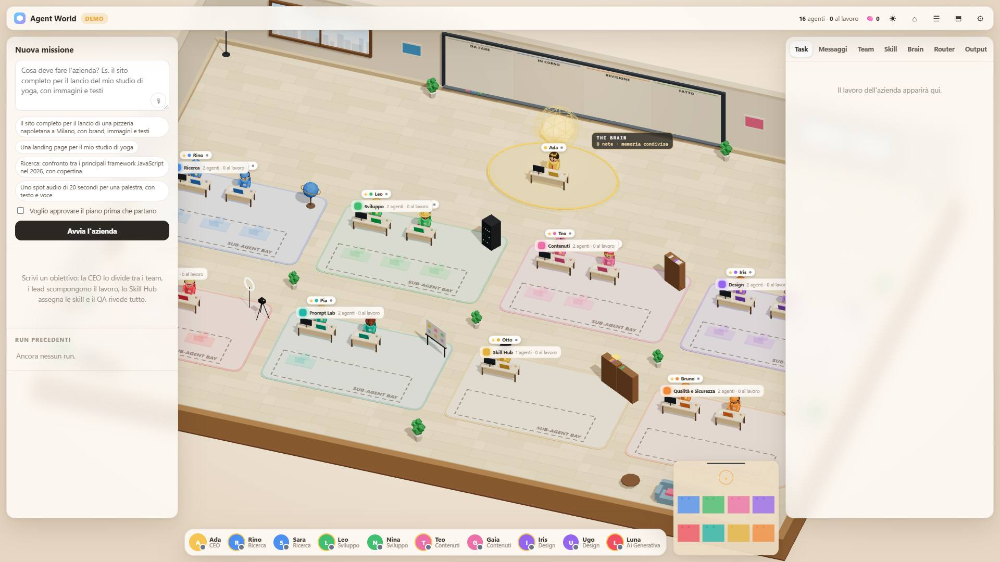 | 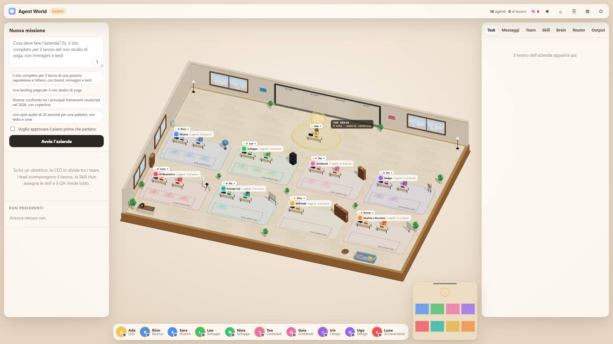 |
| Pannello destro | 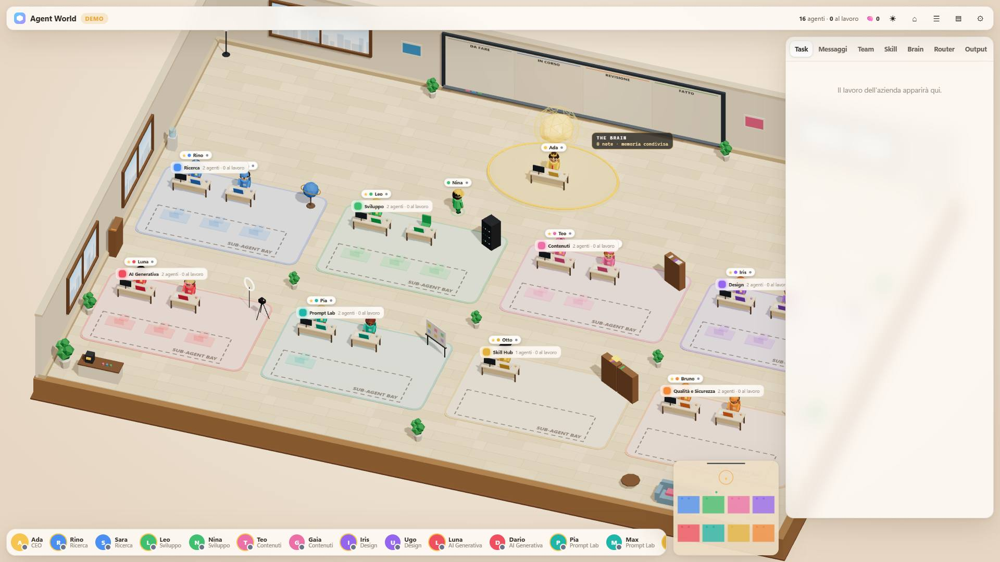 | 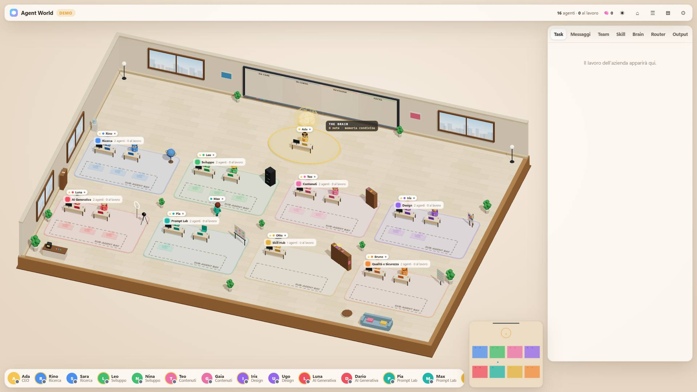 |
| Nessun pannello | 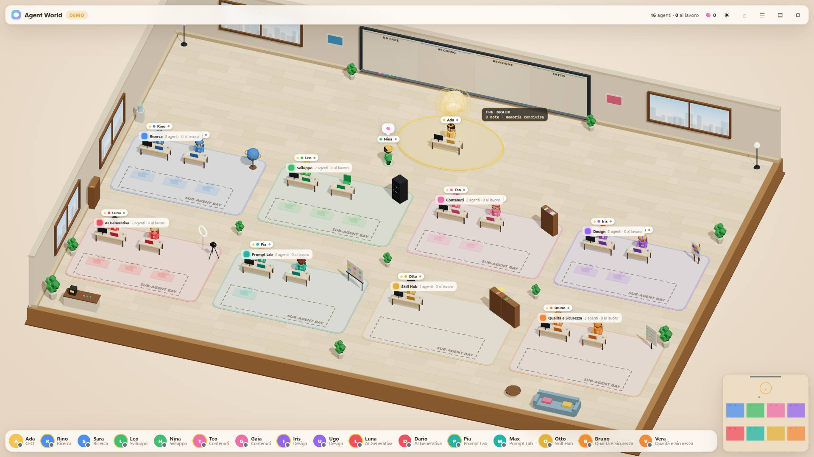 | 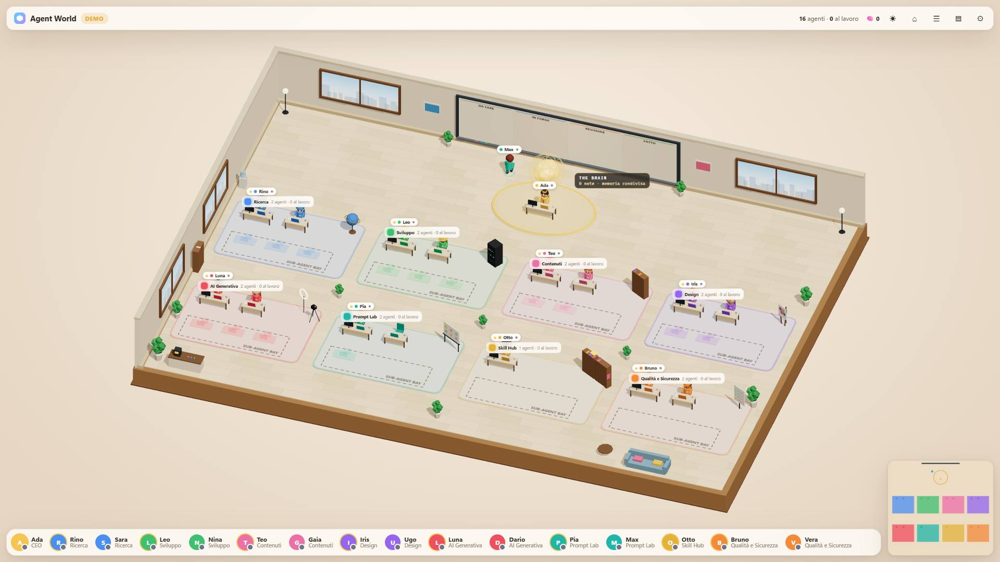 |

### Cubi: stress R1–R5 (A9)

| Caso | Prima (`c1312ff`, rimisurato) | Dopo |
|---|---|---|
| R1: lo split viene superato dalla presa | ✖ il cubo di `nina` a `(-9.9, 1.0, -2.8)` in coordinate locali | ✔ |
| R2: pickup ancora in volo allo split | ✖ `teo` porta il cubo grande eliminato | ✔ |
| R3: consegna o affondamento durante la presa | ✖ `ugo` e `dario` portano cubi spariti, `ugo` a `(0, 3, -16.9)` | ✔ |
| R4: reset durante la presa | ✖ `vera` porta un cubo del run precedente | ✔ |
| R5: seconda presa con un cubo in mano | ✖ il primo resta attaccato a `max` | ✔ il primo sulla scrivania, il secondo in mano |

### Run completo (A10)

Stessa missione di T0 ("Il sito completo per il lancio di una pizzeria napoletana a Milano, con brand, immagini e testi"), a 1920×1080 con entrambi i pannelli e ritmo normale, partendo da una pagina appena caricata. La sonda `__checks.runProbe` rifà i controlli di T0 e T2:
- le tolleranze sui cubi in uscita sono misurate in **tempo del mondo**, perché `frame()` limita un passo a 0,05 s e un browser che disegna meno di 20 fps fa girare il mondo più lento dell'orologio;
- a fine run aspetta che gli effetti finiscano invece di un tempo fisso.

| Verifica | T0 (`c1312ff`) | T2 | **T8** |
|---|---|---|---|
| Esito | `completed`, 6 workstream, 17/17 task | identico | identico: 155 s, 60,7 fps, mondo a 1× l'orologio |
| Cubi: pickup, split, prese, consegne, drop | 6 / 6 / 17 / 17 / 23 | 6 / 6 / 17 / 17 / 23 | 6 / 6 / 17 / 17 / 23, 0 affondamenti |
| Anomalie dei cubi durante il run | 1 (R1, `research-sub1`) | 0 | **0** |
| Cubi rimasti, personaggi con `carrying` a fine run | 0, nessuno | 0, nessuno | 0, nessuno |
| Effetti congelati a fine run (anelli / scintille) | 144 / 170 | 0 / 0 | **0 / 0**, 0 effetti attivi |
| Verdetti con il revisore alla scrivania | 23/23, distanza 1,0–1,1, ritardo max 1,04 s | 23/23, 1,0–1,1 | 23/23 (17 promossi), distanza 1,0–1,1, ritardo max 0,96 s |
| Sub-agenti | 2, entro 1,6 dal posto nella bay | — | 2 creati e rimossi; mentre lavorano sono al loro posto (0), al massimo a 1,59 per prendere il cubo |

Il numero di sub-agenti dipende dal piano demo. In un giro intermedio ne è stato creato uno solo, ed è stato rimosso regolarmente.

**Momenti chiave (S6.2)**, catturati dal runner quando la sonda li segnala:

| | |
|---|---|
| 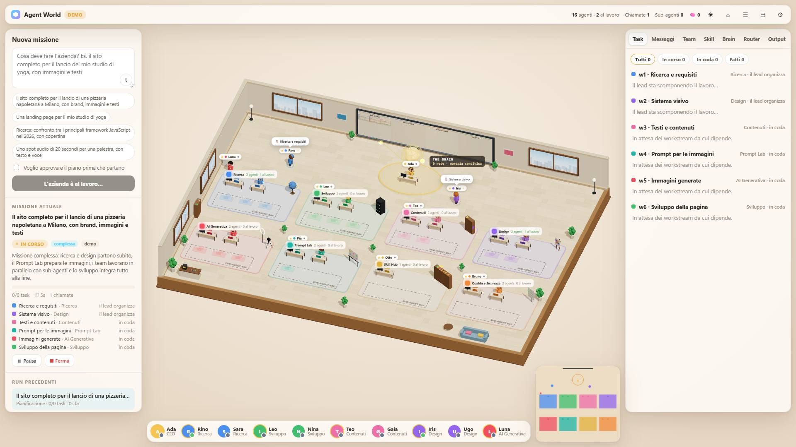 Piano sulla lavagna |  Split in cubi |
|  I worker prendono i cubi | 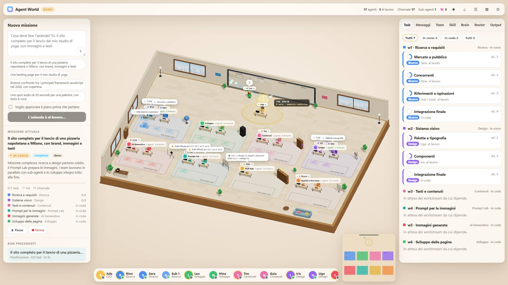 Sub-agente nella bay |
| 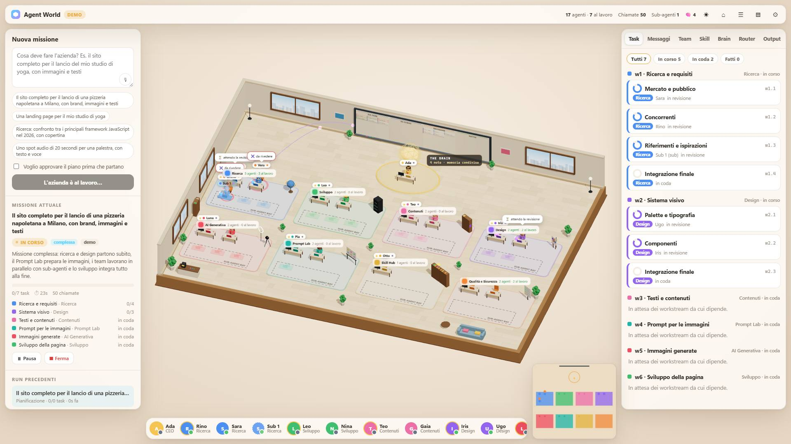 Verdetto del QA alla scrivania | 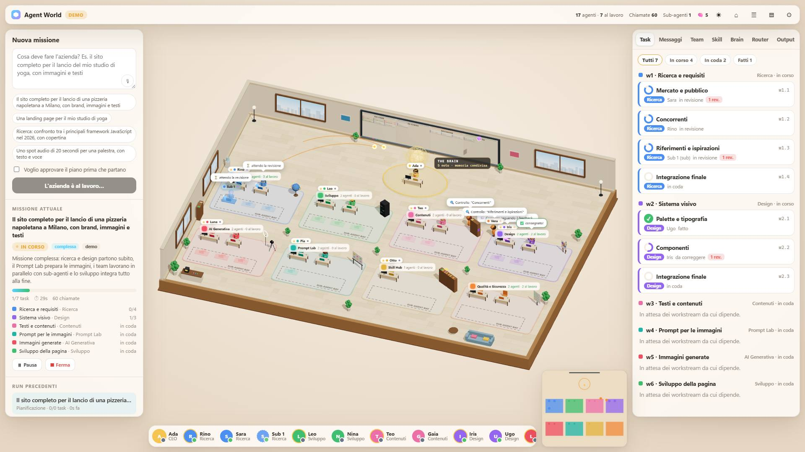 Consegna |
| 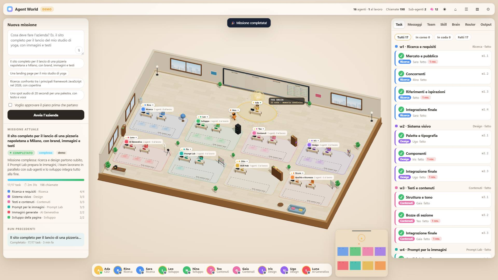 Fine del run | |

### Criteri di accettazione

| ID | Criterio | Esito | Evidenza |
|---|---|---|---|
| A1 | Tutto l'ingombro nell'area libera, centrato, ≥ 95% dell'asse più stretto | ✔ | `world-test.js`: 20 layout. Browser: 0% di pavimento e 0 punti dell'ingombro sotto l'interfaccia in 9 viste (Prima: fino a 38,4% e 8 punti); `framing()`: 0 punti fuori dall'area libera con LR, -R e -- |
| A2 | Target al centro dell'area libera a zoom 0,5–4 | ✔ | `world-test.js`, ±1 px su 20 layout |
| A3 | Pan 1:1 | ✔ | `world-test.js` (100 px = 100 px). Browser: il punto afferrato finisce sotto il cursore con scarto 0,01 px, anche con un riadattamento in corso |
| A4 | Fallback sotto 240×160 | ✔ | `world-test.js` |
| A5 | `fly`, `stop`, effetti annidati | ✔ | `world-test.js`, 6 controlli |
| A6 | Pannelli animati in 0,35 s, senza frame deformati | ✔ | `framing()`: 4 aperture e chiusure con 0 px di salto al clic, 0,35 s esatti, fine sul fit; resize con aspetto e buffer giusti subito |
| A7 | In manuale i pannelli non muovono la vista, ⌂ torna in automatico | ✔ | `manualMode()`: 25/25. Input reale via DevTools (eventi del browser, cattura del puntatore vera): clic sul pavimento resta automatico, trascinamento e rotella passano a manuale, un pannello poi non sposta nulla (0 px), ⌂ torna in automatico |
| A8 | Focus alla grandezza di oggi (±5%) | ✔ | `absoluteScale()`: rapporto 1,000000 e centro a 0 px in 9 combinazioni di viewport e pannelli, anche con un clic reale; limiti di zoom, minimappa, etichette, movimenti senza tagli. La trappola rimessa apposta viene colta |
| A9 | Stress dei cubi senza orfani | ✔ | R1–R5 puliti (Prima: 5/5 ✖, identici a T0) |
| A10 | Run completo osservato, screenshot prima e dopo | ✔ | Tabella sopra; 3 + 3 viste e 7 momenti del run in `docs/specs/img/` |
| A11 | `npm test` e `node --check` verdi | ✔ | `npm test` verde (world, router, smoke, flows); `node --check` su `main.js`, sui 7 moduli di `public/js/world/` e sugli script nuovi |

**Tutti gli 11 criteri sono verdi.** Il giro finale di `npm run test:browser` ha dato 123 controlli su 123.

### Test consolidati (`scripts/`)

| File | Cosa contiene |
|---|---|
| `browser-test.js` | Il runner: server demo isolato, Edge o Chrome headless, fasi `views`, `checks`, `cubes`, `input`, `run`; `--shots` per gli screenshot, `--json` per i risultati, `--root` e `--tag prima` per misurare un altro checkout |
| `browser/lib.js` | Helper lato pagina: orologio fisso a 60 fps, disegno sospeso, input sintetico, ingombri misurati come `main.js`, `session()` che ripristina tutto |
| `browser/coverage.js` | A1 come T0, indipendente dal codice: gira anche su `c1312ff` |
| `browser/framing.js` | A1 sulla `World`, A6, resize, 16/16 clic |
| `browser/manual-mode.js` | A7 (ex `__a7`, T6) |
| `browser/absolute-scale.js` | A8 e S2.5–S2.7 (ex `__a8`, T7), con `mutate` per la trappola |
| `browser/cube-stress.js` | A9 (ex `__cubeStress`, T0/T2), indipendente dal codice |
| `browser/run-probe.js` | A10: la sonda del run |

`npm run test:browser` non fa parte di `npm test`: richiede un browser installato e circa 6 minuti, di cui 2,5 di missione; `--skip-run` lo porta a circa un minuto. Gli script lato pagina si possono anche incollare nella console, prima `lib.js`.

**Difetti del runner trovati e corretti durante T8** (strumento di test, non prodotto):
- **Browser rimasti aperti.** Su Windows `msedge.exe` passa l'avvio a un altro processo, quindi chiudere il processo lanciato non chiude il browser. Nove esecuzioni avevano lasciato 85 processi headless: la macchina rallentava e un run è sceso a 12,6 fps, con la sonda che allora segnalava falsi orfani. Ora il browser viene chiuso con `Browser.close` via DevTools, il suo albero viene terminato solo se risponde ancora (un PID chiuso potrebbe essere già di un altro processo), e il profilo temporaneo viene rimosso con nuovi tentativi. Dopo le correzioni: 0 processi e 0 cartelle rimaste.
- **Punti dell'input reale.** Un punto "libero" per il raycast 3D può avere sopra un'etichetta DOM. Un clic lì è un focus sulla stanza, e la rotella non arriva al canvas. Lo stesso succede se l'etichetta di un agente che passeggia attraversa il punto: è successo in 2 ripetizioni su 4. Ora il punto si sceglie subito prima di ogni azione, solo dove `elementFromPoint` restituisce il canvas, e le passeggiate decorative degli agenti restano ferme durante la fase. Risultato: 0 fallimenti su 6 ripetizioni.
- **Osservazione, comportamento preesistente:** la rotella sopra un'etichetta non zooma, perché le etichette ricevono i puntatori per il clic.

### Difetto nuovo N4: le etichette delle stanze coprono quelle dei worker (preesistente, fuori perimetro)

Le etichette delle stanze sono ancorate all'angolo posteriore sinistro della stanza, dove siede un worker, e stanno sopra le etichette degli agenti. Quota dell'etichetta di ogni worker inattivo coperta dall'etichetta della sua stanza (7 worker, 1920×1080). La disposizione relativa delle etichette dipende solo dallo zoom effettivo, quindi le righe valgono per qualunque layout con lo stesso zoom:

| Vista | Zoom effettivo | Worker con il centro dell'etichetta coperto | Sovrapposizione |
|---|---|---|---|
| `main`, vista iniziale | 1 | 6/7 | 60–97% |
| Zoom 0,8 (come la vista completa -- e -R, 0,79) | 0,8 | 7/7 | 93% |
| Vista completa, LR | 0,61 | 7/7 | 89% |
| Zoom 1,3 | 1,3 | 1/7 | 12–100% |
| Focus su un agente | 2,2 | 0/7 | 0–4% |

Nella vista completa, quindi, si leggono solo le etichette dei lead e delle stanze; dei worker spunta un frammento. **Esisteva già su `main`** e non è coperto da S1–S5, quindi per S6.3 non lo correggo qui.

Corregge però una premessa di T7: la soglia `far` a 0,55 è stata scelta misurando solo le sovrapposizioni tra etichette di agenti (nota aggiunta nella sezione T7). Opzioni per un ticket separato:
1. spostare l'etichetta della stanza sul bordo anteriore, dove non ci sono scrivanie;
2. mettere le etichette degli agenti sopra quelle delle stanze;
3. nascondere le etichette dei worker inattivi finché sono coperte, per esempio con `far` di nuovo a 0,95, che le fa sparire invece di lasciarne un frammento.

### Limiti residui

- **N2** (scheda nascosta, client in ritardo): invariato, fuori perimetro, per un ticket separato.
- **N4**: vedi sopra.
- **Pressione tenuta ferma durante un'animazione** (T6): risolto nella code-review (R1).
- **Velocità percepita del focus** dalla vista completa (T7): risolto nella code-review (R5).
- **Mouse reale** (limite di T6): ora coperto dagli eventi del browser via DevTools, oltre che dal QA visivo dell'utente.
