# Spec 02 — Report

Riferimenti: [spec](02-ui-overlaps.md), [ticket](02-ui-overlaps.tickets.md). Gli ID P\*, E\*, V\*, N\* e Q\* rimandano alla spec.

## Prima (T0)

| | |
|---|---|
| **Data** | 2026-10-13 |
| **Codice misurato** | `feat/ui-overlaps` a `51b11e0`: `main` (`0914146`) più la spec e i ticket, nessun file di `public/` cambiato |
| **Strumento** | `node scripts/browser-test.js --only overlaps,labels`, Edge headless via DevTools, server demo proprio |
| **Durata delle fasi nuove** | `overlaps` 58–66 s, `labels` 21–22 s (33 s con gli screenshot): circa 85 s in tutto, sotto l'obiettivo di 3 minuti |

**In breve**
1. Le due fasi nuove coprono 1456 casi della matrice dei pannelli (§3.1) e 180 stati della matrice delle etichette (§3.2).
2. Ogni rosso della baseline ha la sua causa tra i difetti noti, e nessun difetto nuovo: N6, Q1 e Q2 per 24 verifiche (T1), Q3 e Q4 per 9 (T2), N4 per 6 (T3), Q5 e la rotella per 3 (T4).
3. Il calcolo delle varianti è validato al pixel: con l'ancora di oggi coincide con le etichette disegnate entro 0,52 px; A, B e C coincidono entro 0,52, 0,66 e 0,81 px con le stesse varianti disegnate dal CSS.
4. Nessuna variante rispetta tutti i criteri in tutta la matrice. **B** è quella con meno conflitti: copre il punto più basso di 3 sub-agenti in 2 stati su 180 e il 27% della scritta "SUB-AGENT BAY". A copre i sub-agenti in 25 stati; C copre i nomi delle stanze posteriori in 26 stati.
5. V4, V12 e la verifica degli ingressi sono stati visti fallire. La suite completa è verde: 130 verifiche della spec 01, 39 nuove, 42 rossi attesi, in 4 min 31 s.

### 1. Lo strumento

- **Fase `overlaps`** (P1–P5):
  - 9 dimensioni della finestra: le 5 della matrice più i bordi delle media query (1251, 1250, 901 e 900 px);
  - da ogni layout di partenza, ogni ingresso con l'elemento vero: ☰, ▤, una scheda, l'etichetta di una stanza, "Vai alla stanza", un membro del roster, ✕;
  - in modalità stretta, i layout di partenza sono le classi `closed` lasciate dalla modalità larga (Q2);
  - 24 sequenze di resize oltre 1250 e oltre 900 px, con l'inspector chiuso e aperto;
  - 3 passeggiate casuali da 25 passi, con seme fisso;
  - P4 confronta ogni disposizione con quella di una pagina appena caricata (19 riferimenti);
  - l'inspector aperto ha sempre il contenuto più alto: 6 eventi e 8 messaggi.
- **Fase `labels`** (E1–E7):
  - 1920×1080, 1440×900 e 2560×1440 × LR, -R e -- × 10 viste (completa; zoom effettivo 0,8, 1 e 1,3; focus su un worker per fila; primo piano; focus su una stanza per fila) × bay vuote o piene (14 sub-agenti);
  - E1 con un fumetto aperto su ogni agente, le altre misure a fumetti chiusi;
  - E7 con eventi veri della rotella inviati via DevTools.
- **Rossi attesi:** `scripts/browser/known-red.json`, 42 voci con il ticket che le chiude.
- **Ingressi applicati:** una verifica per dimensione controlla che ogni ingresso della matrice sia stato applicato davvero. Senza la sua precondizione, "Vai alla stanza" verrebbe saltato in silenzio. Provato togliendo la preparazione per un giro: 9 verifiche rosse, una per dimensione.
- **Processi del browser:** a fine suite il runner controlla i processi con il profilo dell'esecuzione (V12).

### 2. Pannelli: N6, Q1–Q4

| # | Caso misurato | Misura | Spec §1.1 |
|---|---|---|---|
| N6 | 1920×1080, L- poi una scheda | minimappa 1704–1908 invece di 1292–1496, sotto il pannello destro per 22.848 px² (204 × 112); roster fino a 1692 invece di 1280, cioè 184 px dentro il pannello | uguale |
| N6 | 1200×800, L- poi una scheda | roster fino a 972 invece di 816: 144 px dentro il pannello | uguale |
| Q1 | 1200×800, pannello destro chiuso | roster fino a 972 invece di 1188: 216 px vuoti | uguale |
| Q1 | anche a 1250, 1000 e 901 px | 216 px vuoti in ognuna | — |
| Q2 | pannelli chiusi a 1920, poi 800×600 | roster 8–572 (o 12–572) invece di 8–792; inspector a 12 px invece di 8 | uguale |
| Q3 | 1000×800, LR, inspector | 324–664 invece di 324–616: 36 px sopra il pannello destro, su 580 px di altezza | 36 px; l'altezza nella spec era 316 px, con un contenuto più corto |
| Q3 | 901×800, LR, inspector | 324–664 invece di 324–517: 135 px sopra il pannello | — |
| Q4 | 1280×800, LR, inspector alto | 354–694 invece di 354–640: sopra la minimappa per 42 × 46 px | 42 px in larghezza; 96 px in altezza nella spec, misurati con un contenuto sintetico più alto di quello reale |
| Q4 | 1251×800, LR, inspector alto | sopra la minimappa per 71 × 46 px | — |

Quante verifiche falliscono, su quanti casi:

| Verifica | Rossi / casi | Causa | Ticket |
|---|---|---|---|
| P1 (sovrapposizioni senza inspector) a 1920, 1280, 1251 | 6/64, 6/32, 6/32 | N6: minimappa sotto il pannello | T1 |
| P2 (roster) a 1920, 1280, 1251 | 6 ciascuna | N6 | T1 |
| P2 (roster) a 1250, 1200, 1000, 901 | 16–28 ciascuna | Q1, più N6 | T1 |
| P2 (roster e inspector) a 900 e 800 | 24/32, 36/48; inspector 2/4, 6/12 | Q2 | T1 |
| P3 (minimappa) a 1920, 1280, 1251 | 6 ciascuna | N6 | T1 |
| P4 (nessuna memoria) a 1920, 1280, 1200, 1000, 800 | 6, 6, 6, 6, 36 | N6, Q2 | T1 |
| P1 e P2 con l'inspector a 1280, 1251, 1000, 901 | 1/4 ciascuna | Q3, Q4 | T2 |
| Passeggiate 1 e 2 | passi 8–11; 4–6 e 13–24 | N6, Q1 | T1 |
| Passeggiata 3 | passi 23 e 25 | Q3 | T2 |

**Verdi già oggi:** P1 a 1250, 1200, 1000, 901, 900 e 800 px (senza inspector); P3 sotto 1250 px; P5 a ogni dimensione larga. Restano come guardie contro le regressioni.

### 3. P5 e la sua prova (V4)

- A 1920, 1280, 1200 e 1000 px, partendo dalla vista automatica, ☰, ☰, ▤ e una scheda riadattano la vista ogni volta: 0% del pavimento e 0 punti dell'ingombro sotto l'interfaccia.
- **Mutazione permanente:** con gli ingombri congelati apposta, la scheda che riapre il pannello lascia il 16,5% del pavimento e 5 punti dell'ingombro sotto l'interfaccia. La verifica lo coglie.

### 4. Etichette, codice di oggi

| Verifica | Esito | Misura (caso peggiore) | Ticket |
|---|---|---|---|
| E1 | rosso a 1920, 1440, 2560 | a zoom 1 un'etichetta o un fumetto di agente coperto al 100%, 8 elementi coperti | T3 |
| E2 | verde | le etichette delle stanze stanno sopra quelle degli agenti iniziali, quindi oggi nessuna etichetta di agente copre un nome | — |
| E3, E4 | verdi | — | — |
| E5 | rosso a 1920, 1440, 2560 | in tutti i 180 stati, 8 lead e worker hanno il corpo (a 0,8 e 1,2 di altezza) sotto l'etichetta della stanza: un clic lì apre la stanza invece di selezionarli. I nomi delle stanze visibili prendono tutti il clic | T3 |
| E6 | rosso a 1440×900 | con `far` attivo, 15 etichette nascoste su 22 intercettano il puntatore (bay piene); 1 su 8 con le bay vuote | T4 |
| E7 | rosso | un passo di rotella sopra un'etichetta di stanza o di agente non zooma (rapporto di scala 1), sul canvas sì (0,9403) | T4 |

E5 è una conseguenza di N4 che la spec 01 non aveva misurato: l'etichetta nell'angolo posteriore sinistro sta anche sopra il corpo del lead e dei worker, non solo sopra le loro etichette.

**Riproduzione della spec 01:** con l'ancora di oggi, nella vista completa a 1920×1080 con LR, i worker con il centro dell'etichetta sotto quella della stanza sono 7 su 7, come nella spec 01. La copertura misurata qui è 92% per tutti, contro l'89% della spec 01. La differenza è nel metodo: qui area coperta su area dell'etichetta, con la scala delle etichette dopo la review R6.

### 5. Le varianti di N4 (per D8)

**Come sono misurate.** Ogni variante è calcolata dalla pagina, con l'ancora e l'allineamento del §4.3 della spec:
- con l'ancora di oggi, il calcolo coincide con le etichette disegnate entro **0,52 px** in tutti i 180 stati;
- A, B e C, disegnate davvero dal CSS con una patch che vive solo nel test, coincidono con il calcolo entro **0,52, 0,66 e 0,81 px** (casi peggiori: A nel focus su un agente, B nel primo piano, C nel focus).

**Tabella.** Caso peggiore su tutta la matrice (3 dimensioni × 3 layout × 10 viste × bay vuote o piene), e in quanti stati la misura non è zero. Dalla terza colonna in poi le misure usano l'ordine di T3, cioè le etichette degli agenti sopra quelle dei luoghi (E5 non dipende dall'ordine).

| Variante | E1 con l'ordine di oggi | E1 con gli agenti sopra | E2: nome della stanza coperto | E3: fuori dall'area libera | E4: etichette di luoghi sovrapposte | E5: agenti con il corpo sotto un'etichetta | Scritta "SUB-AGENT BAY" coperta |
|---|---|---|---|---|---|---|---|
| oggi | 100% (144/180) | 0 | 229 px² (28/180) | 0 | 0 | 8 lead e worker (180/180) | 0 |
| **A** | 34% (72/180) | 0 | 0 | 0 | 0 | **12 sub-agenti** (25/180), a ogni altezza | 0 |
| **B** | 52% (72/180) | 0 | 0 | 0 | 0 | **3 sub-agenti** (2/180), solo il punto più basso (0,4) | **27%**, sempre |
| **C** | 82% (72/180) | 0 | **303 px²** (26/180) | 0 | 0 | **4 lead e worker** (2/180) | 0 |

**Lettura:**
- **L'ordine di E1 serve con qualunque variante.** Solo spostando le etichette, i fumetti e le etichette degli agenti restano coperti nel 40% degli stati (72/180). Con gli agenti sopra, E1 vale 0 per tutte. È la stima del §4.3 della spec, ora misurata.
- **A** lascia libere le etichette dei worker, ma la sua etichetta sale sopra i sub-agenti seduti nella bay. Succede in 25 stati, quasi tutti con le bay piene: un clic sul corpo di un sub-agente lì apre la stanza.
- **B** è centrata sul bordo anteriore. Tocca soltanto i piedi di 3 sub-agenti in 2 stati su 180. In cambio copre in parte la scritta disegnata sul pavimento della bay (27% nel caso peggiore, la stanza Sviluppo), che è un elemento decorativo.
- **C** sta fuori dalla stanza. Finisce però nel corridoio, dove le etichette e i fumetti della fila anteriore la coprono (fino a 303 px² del nome, in 26 stati); in 2 stati sta sopra il corpo di 4 agenti della fila anteriore.

**Consiglio: B**, con l'ordine di E1. Come A, non tocca né i nomi delle stanze né il corpo di lead e worker. Il suo conflitto con i sub-agenti, però, è molto più piccolo: il punto più basso di 3 sub-agenti in 2 stati, contro 12 sub-agenti interi in 25 stati per A. Il prezzo è la scritta della bay, che è solo decorativa. Se la scegli, propongo di accettarli come eccezioni nella spec, con questi numeri:
- E5: il punto più basso di 3 sub-agenti in 2 stati su 180;
- la scritta della bay coperta fino al 27%.

**Screenshot** a 1920×1080, bay piene, vista completa:

| | Due pannelli | Nessun pannello |
|---|---|---|
| oggi |  |  |
| A |  |  |
| B |  |  |
| C |  |  |

Gli screenshot dei casi dei pannelli: `img/02-prima-n6-*`, `q1-*`, `q2-*`, `q3-*`, `q4-*`.

### 6. Processi del browser (V12)

- Nelle esecuzioni normali di T0 non è rimasto nessun processo.
- **Prova:** con la chiusura del browser saltata da una modifica temporanea, poi tolta e mai committata, `--only cubes` ha dato `FAIL runner no browser process left with this run's profile` con 17 PID. Il runner li ha poi chiusi: a fine prova i processi con `agent-world-profile` erano 0.

### 7. Suite completa

`npm run test:browser`, con la missione demo: **ALL OK**, in 4 min 31 s.
- le 130 verifiche della spec 01 restano verdi (views, checks, cubes, input, run): il refactor degli aiuti per gli eventi veri di `input` non cambia nulla;
- 39 verifiche nuove verdi, cioè le guardie di P, E2–E4, il modello, gli ingressi e i processi;
- 42 rossi attesi: 24 per T1, 9 per T2, 6 per T3, 3 per T4;
- missione completata in 152 s a 67 fps, nessun processo del browser rimasto.

La verifica degli ingressi è stata aggiunta dopo questo giro, e le fasi nuove sono state rilanciate da sole (ALL OK, stessi rossi attesi).

## Dopo (T1–T4)

| | |
|---|---|
| **Data** | 2026-10-13 |
| **Codice misurato** | `feat/ui-overlaps` a `9613ea5` |
| **Commit dello step 4** | `7c8edc1` T1; `0670445` e `554d700` T2; `2cde96a` T3; `5b89f7d` e `9613ea5` T4 |
| **Codice di produzione** | 3 file in `public/`, +48 / −21 righe. Test: 6 file in `scripts/`, +1135 / −57 righe |
| **Suite completa** | `npm run test:browser`: **ALL OK**, 226 verifiche, 0 rossi attesi (`known-red.json` è `{}`), in 6 min con gli screenshot. `npm test` verde |

**In breve**
1. I 42 rossi della baseline sono tutti verdi e il file dei rossi attesi è vuoto. Le 130 verifiche della spec 01 restano verdi, compresa la missione demo.
2. Pannelli: 0 sovrapposizioni e 0 differenze da una pagina appena caricata in 1604 casi. L'inspector non scorre mai di lato, su 74 larghezze da 360 a 1920 px.
3. Etichette: 0% di etichette e fumetti degli agenti coperti (prima fino al 100%). 0 lead o worker con il corpo sotto un'etichetta di stanza (prima 8 in ogni stato). Le eccezioni di D8 sono esattamente quelle previste.
4. Puntatore: 0 etichette nascoste che intercettano i clic (prima 15 su 22). La rotella sopra un'etichetta zooma come sul canvas: rapporto 0,9403 e punto sotto il cursore fermo entro 0,05 px.
5. Durante il ciclo è emerso e stato corretto un difetto nuovo nel perimetro: Q6, le parole che non vanno a capo nell'inspector.

### 1. Criteri di accettazione

| ID | Criterio | Prima | Dopo |
|---|---|---|---|
| V1 | P1: nessuna sovrapposizione tra elementi fissi | rosso: N6, Q3, Q4 | **verde**: 0 px² in 1604 casi, scansione dell'inspector compresa |
| V2 | P2, P3: colonna e minimappa al loro posto; l'inspector non scorre di lato | rosso: N6, Q1–Q4 | **verde** entro ±0,5 px; nessuno scorrimento su 74 larghezze |
| V3 | P4: nessuna memoria della sequenza | rosso: N6, Q2 | **verde**: 19 riferimenti, 3 passeggiate casuali da 25 passi |
| V4 | P5: riadattamento automatico, A1 della spec 01 a 0% | verde | **verde**; la mutazione degli ingombri congelati è colta (16,5% del pavimento) |
| V5 | P6: suite della spec 01 senza riallineamenti a mano | verde solo con il riallineamento | **verde**: 130 verifiche, riallineamento tolto |
| V6 | E1: etichette e fumetti degli agenti mai coperti dai luoghi | rosso: fino al 100% | **verde**: 0% in 180 stati; l'ordine rimesso al contrario è colto (30,5%) |
| V7 | E2: nomi delle stanze non coperti dagli agenti seduti | verde | **verde**: 0 px² |
| V8 | E3, E4: etichette nell'area libera e senza sovrapporsi | verdi | **verdi**: 0 e 0 |
| V9 | E5: clic sugli agenti e sui nomi delle stanze | rosso: 8 lead e worker in ogni stato | **verde**: 0 fuori eccezione; tutti i nomi visibili prendono il clic |
| — | eccezione D8: piedi di al massimo 3 sub-agenti, in al massimo 2 stati | — | **rispettata**: 3 sub-agenti, solo il punto a 0,4, in 2 stati su 180 |
| — | eccezione D8: scritta "SUB-AGENT BAY" coperta al massimo al 27% | — | **rispettata**: 26,68% nel caso peggiore (Sviluppo) |
| V10 | E6: etichette nascoste insensibili al puntatore | rosso: 15 su 22 | **verde**: 0 |
| V11 | E7: rotella sopra un'etichetta | rosso: nessuno zoom | **verde**: rapporto 0,9403, come sul canvas; deriva 0,03–0,05 px (canvas 0,06); vista in modalità manuale |
| V12 | Nessun processo del browser rimasto | — | **verde** in ogni giro; visto fallire a T0 con 17 processi |
| V13 | `npm test`, suite completa, QA | — | `npm test` e suite verdi. QA dell'utente superato su T1, T2 e T3; **T4 e la verifica finale sono da fare** |

### 2. Pannelli e inspector: i casi della spec

| # | Caso | Prima | Dopo |
|---|---|---|---|
| N6 | 1920×1080, ▤ poi una scheda | minimappa 1704–1908 sotto il pannello; roster 184 px dentro il pannello | minimappa 1292–1496, roster 354–1280: 12 px da pannello e minimappa |
| Q1 | 1200×800, pannello destro chiuso | roster fino a 972: 216 px vuoti | roster fino a 1188 (lo stesso a 1250, 1000 e 901 px) |
| Q2 | pannelli chiusi a 1920, poi 800×600 | roster 8–572; inspector a 12 px dal bordo | roster 8–792; inspector a 8 px |
| Q3 | 1000×800 e 901×800, LR, inspector | 36 e 135 px sopra il pannello destro | 324–616 (292 px) e 324–517 (193 px), nella colonna |
| Q4 | 1280×800, LR, inspector alto | 42 × 46 px sopra la minimappa | 354–640 (286 px), 12 px prima della minimappa |
| Q6 | link senza punti di a capo in chat | la chat scorreva di lato a ogni dimensione larga (489 px in 306) | va a capo; nessuno scorrimento nemmeno a 193 px |

| | Prima | Dopo |
|---|---|---|
| N6, 1920×1080 | 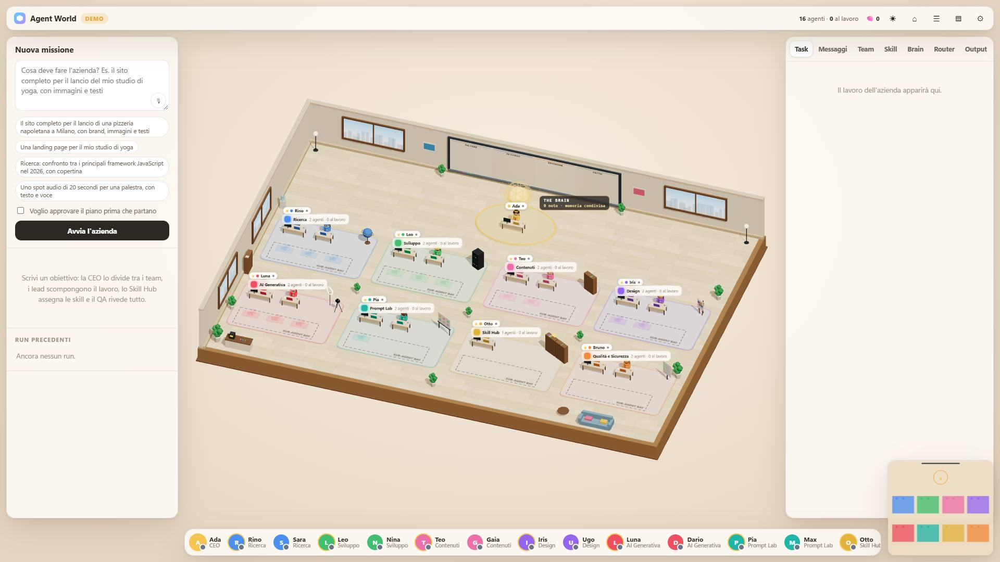 | 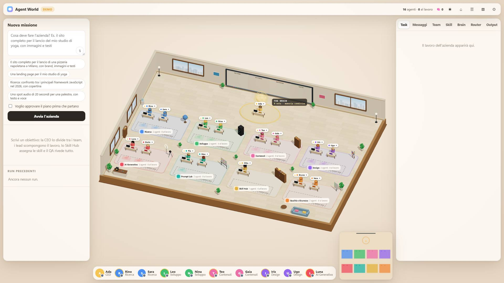 |
| Q1, 1200×800 | 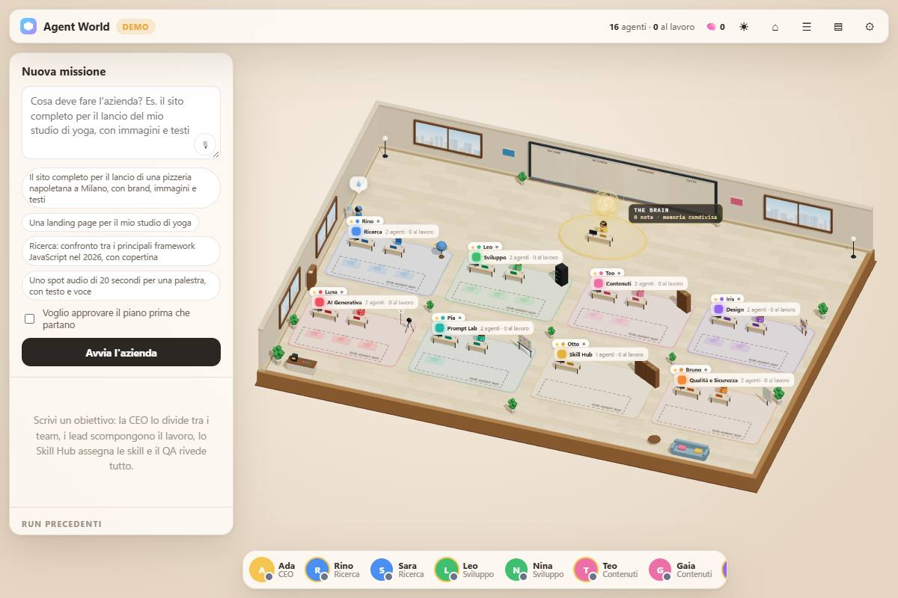 | 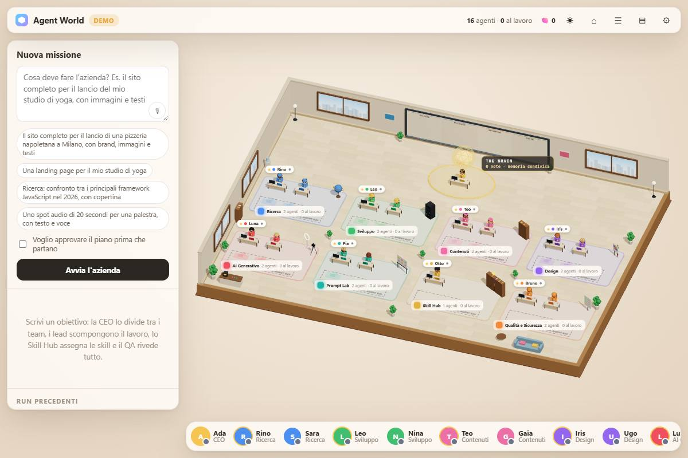 |
| Q2, 800×600 | 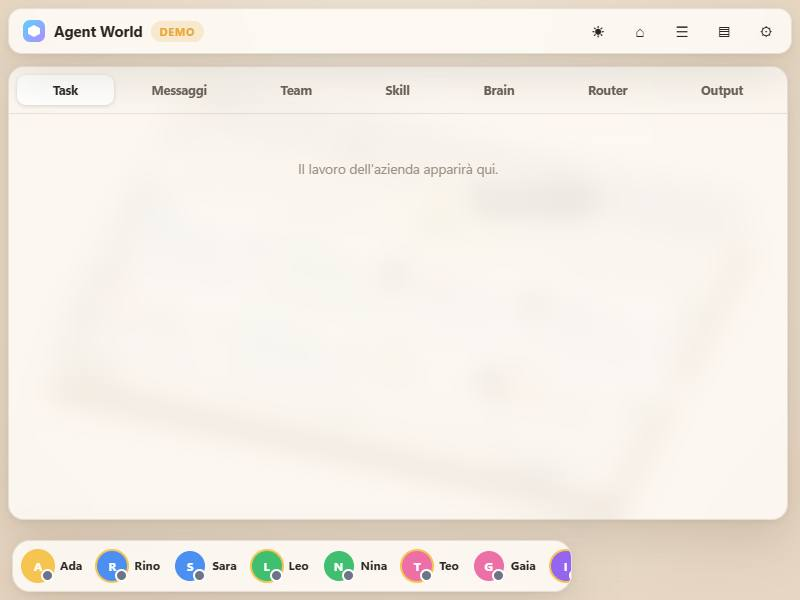 | 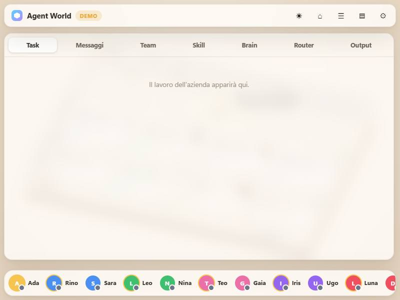 |
| Q3, 1000×800 | 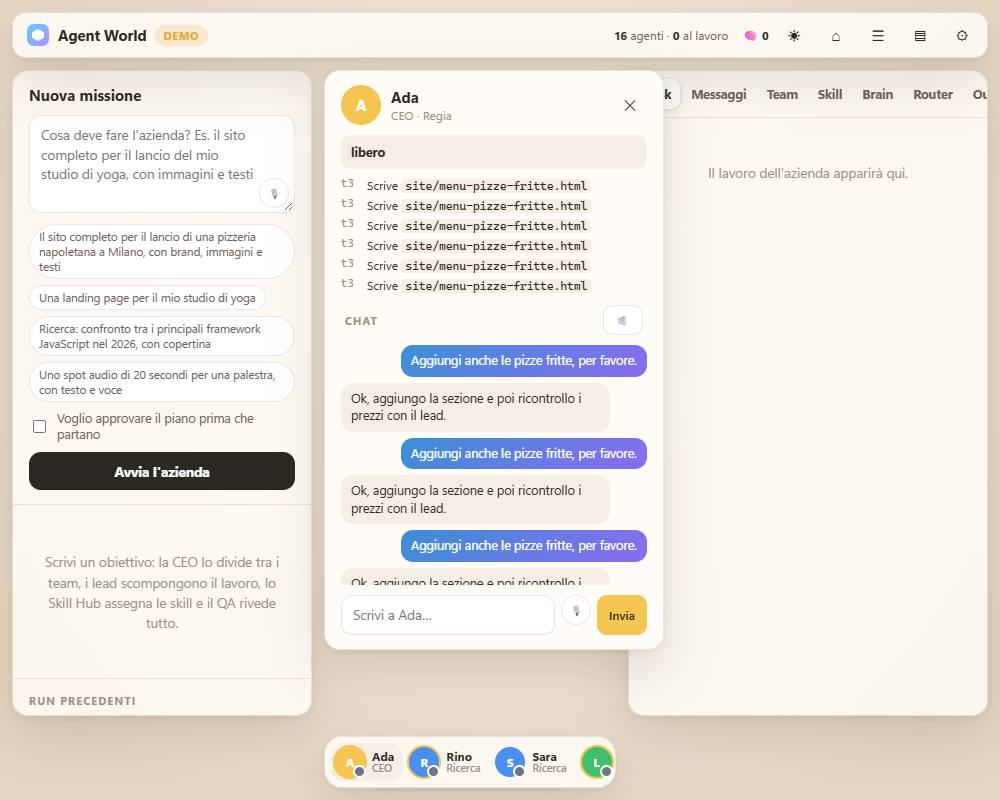 | 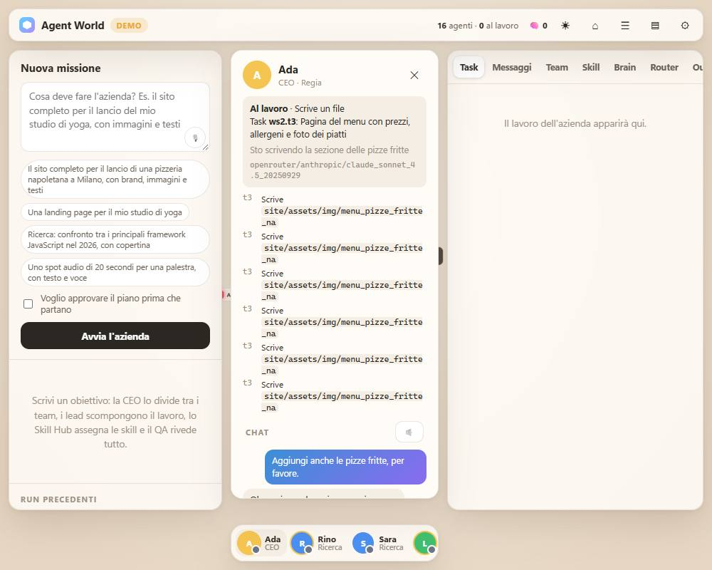 |
| Q4, 1280×800 | 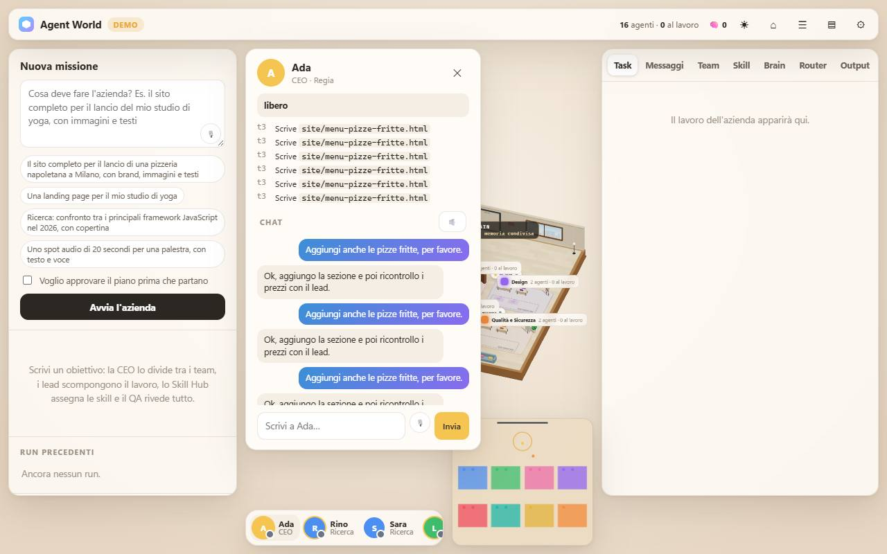 | 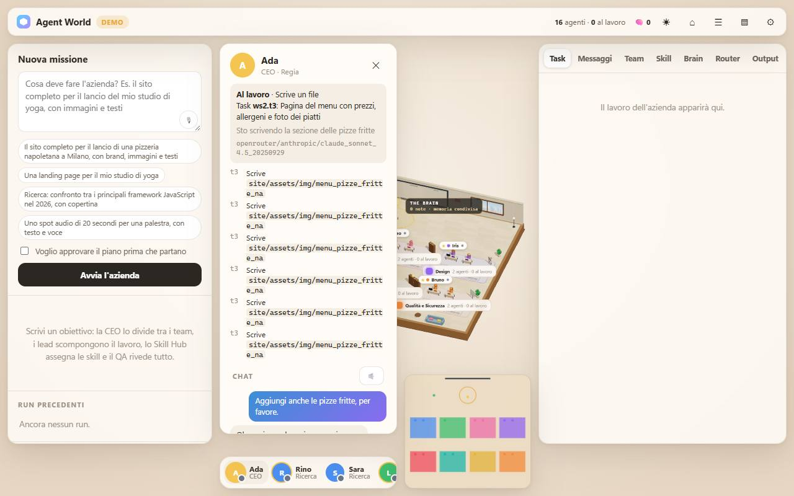 |

### 3. Etichette

| Misura (180 stati) | Prima | Dopo |
|---|---|---|
| Etichette e fumetti degli agenti coperti dai luoghi (E1) | fino al 100%, in 144 stati | 0 |
| Nome di una stanza coperto da agenti seduti (E2) | 0, perché allora le stanze stavano sopra | 0 |
| Etichette fuori dall'area libera, sovrapposte tra loro (E3, E4) | 0, 0 | 0, 0 |
| Lead e worker con il corpo sotto un'etichetta di stanza (E5) | 8, in 180 stati su 180 | 0 |
| Sub-agenti con i piedi sotto un'etichetta (eccezione D8) | — | 3, in 2 stati |
| Etichette nascoste che intercettano il puntatore (E6) | 15 su 22 | 0 |
| Rotella sopra un'etichetta (E7) | nessuno zoom | come sul canvas |

| | Prima | Dopo |
|---|---|---|
| 1920×1080, due pannelli, bay piene |  | 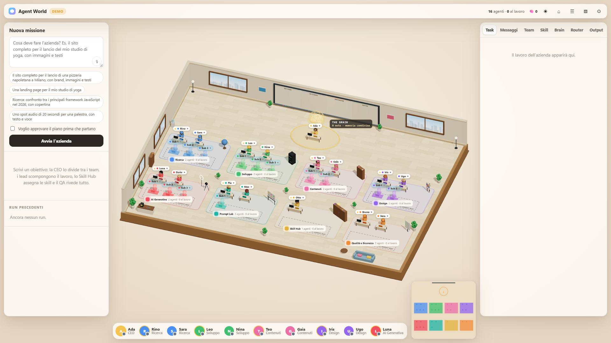 |
| 1920×1080, nessun pannello, bay piene |  | 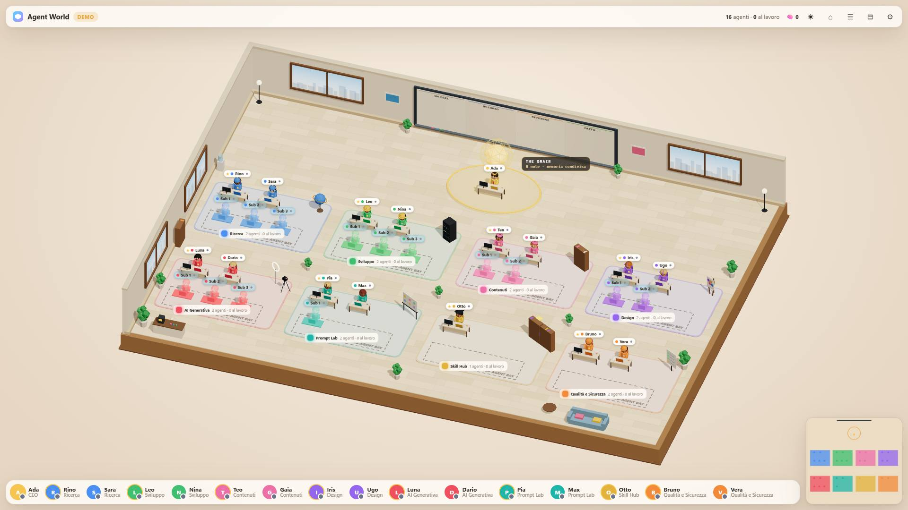 |

**Durante la missione** (`img/02-dopo-run-4-sub-agent-in-the-bay.jpg`), i fumetti degli agenti passano sopra le etichette delle stanze, come chiede E1. Viste complete a 1920×1080: `img/02-dopo-1920x1080-due-pannelli.jpg`, `-pannello-destro`, `-nessun-pannello`.

### 4. Lo strumento, dopo T0

Le verifiche aggiunte durante i ticket, ognuna vista fallire prima della correzione o con una mutazione:

| Ticket | Verifica | Come ha fallito |
|---|---|---|
| T0 | `inputs <dim>`: ogni ingresso della matrice è applicato davvero | senza la precondizione di "Vai alla stanza": 9 rosse |
| T2 | contenuto peggiore dell'inspector (stringhe senza punti di a capo) e scorrimento della chat | sul codice di T1: Q6 a ogni dimensione larga |
| T2 | scansione dell'inspector su 74 larghezze, da 360 a 1920 px | sul codice senza la colonna: P1 a 31 larghezze, P2 a 36 |
| T3 | il modello riconosce la variante disegnata, e deve essere B | sul codice di prima: "oggi" |
| T3 | eccezioni di D8 (piedi, scritta) tenute nei loro limiti | guardie: sono verdi dall'inizio |
| T3 | E1 con l'ordine rimesso al contrario apposta | mutazione permanente, colta a ogni giro |
| T4 | E7 misura anche la deriva del punto sotto il cursore | con la posizione dell'evento sbagliata: 48–68 px, rossa |

### 5. Note e limiti

- **Eccezioni di D8.** Restano esattamente quelle previste a T0. Il margine sulla scritta della bay è piccolo: 26,68% contro il limite del 27%. Se cambiassero il font o le dimensioni della bay, la guardia lo segnalerebbe.
- **Etichetta del Brain.** Ora sta sotto le etichette degli agenti, come tutti i luoghi (E1): un'etichetta o un fumetto di un agente vicino, per esempio di Ada, può coprirla.
- **Modalità stretta.** Pannello aperto e inspector restano overlay che possono coprirsi tra loro: è un non-obiettivo della spec.
- **Osservazione, non un difetto della spec:** in modalità stretta la classe `open` di un pannello sopravvive a un passaggio in modalità larga. Tornando stretti, l'overlay si riapre. È il comportamento di prima e nessun requisito lo vieta.
- **Durata.** Nell'ultimo giro, con gli screenshot, `overlaps` ha impiegato 126 s e la missione è girata a 35 fps; senza screenshot `overlaps` impiega 56–68 s. La suite completa richiede 4 min 35 s – 6 min.
- **Fuori perimetro, ancora aperti:** N2, N5 e N7.

### 6. QA finale dell'utente (1920×1080)

1. ▤ chiude il pannello destro, una scheda lo riapre: minimappa e roster stanno accanto al pannello.
2. Un membro del roster con entrambi i pannelli aperti: l'inspector è largo 340 px e non copre nulla.
3. Vista completa in LR, -R e --: le etichette dei worker sono leggibili, i nomi delle stanze stanno al centro del bordo anteriore.
4. Un clic su un lead o un worker vicino all'etichetta della sua stanza seleziona l'agente.
5. **Nuovo in T4:** la rotella sopra l'etichetta di una stanza o di un agente zooma verso il punto sotto il cursore, come sul pavimento.
6. **Nuovo in T4:** allontanandosi finché le etichette dei worker inattivi spariscono, un clic dove stavano non le seleziona più.
